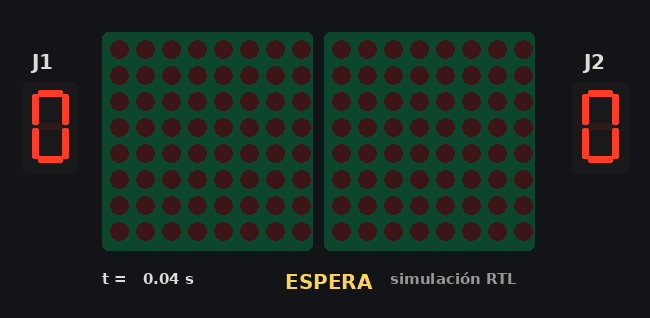

# Pong en FPGA con matriz LED 8 × 32 y controles inalámbricos

**Proyecto final · Electrónica Digital 1**
Universidad Nacional de Colombia, Sede Bogotá · Departamento de Ingeniería Eléctrica y Electrónica

| Integrante | Correo |
|------------|--------|
| Daniel Felipe Castro González | dcastrogon@unal.edu.co |
| Juan David Ortiz Muñoz | juaortizmu@unal.edu.co |
| David Eduardo Chivata Arias | dchivata@unal.edu.co |



*Partida simulada en el módulo de cuatro matrices: lo que se ve es el contenido de los registros de cuatro modelos de MAX7219 después de recibir las tramas seriales de nuestro diseño, es decir, lo que mostrarían los LEDs.*

---

## ¿Qué es esto?

Un Pong para dos jugadores hecho **solo con lógica digital** (sin Arduino ni ESP32) sobre una FPGA **Intel/Altera Cyclone IV E EP4CE10E22C8N**, descrito en Verilog HDL para Quartus II.

* La cancha es el [**módulo matriz LED MAX7219 x4**](https://www.mactronica.com.co/modulo-matriz-led-max7219-x4): cuatro matrices 8 × 8 con cuatro **MAX7219** en cascada en una sola placa, o sea, **8 × 32 LEDs**. El diseño está parametrizado (`ANCHO`), así que también funciona con dos matrices sueltas en 8 × 16, como en la propuesta original.
* Cada jugador tiene un **control inalámbrico** con dos botones: subir y bajar.
* La FPGA va en la tarjeta **A-C4E6E10**. Su display de 8 dígitos muestra el marcador (un dígito por jugador, en los extremos) y un mensaje de estado en el centro: `HOLA`, `-n1-`, `-GOL`, `PAUS`, `GAnA`.
* El buzzer de la tarjeta pita en los rebotes y los goles (se apaga con el DIP 1).
* START y RESET están en los pulsadores K2 y K3 de la tarjeta.

Seguimos al pie de la letra la ruta que propusimos en nuestra guía metodológica:

```
Requisitos → Modelo lógico → RTL → Simulación → Síntesis → Hardware
```

Por eso este repositorio tiene primero la especificación y las fichas de diseño (tablas de verdad, tablas de transición, ecuaciones y máquinas de estados), y solo después el Verilog con sus bancos de prueba.

## Estado del proyecto

| Punto de control | Descripción | Estado |
|------------------|-------------|--------|
| PC0 | Reglas, parámetros y señales documentados | ✅ [`docs/especificacion.md`](docs/especificacion.md), [`docs/decisiones.md`](docs/decisiones.md) |
| PC1 | Tablas, expresiones y diagramas por bloque | ✅ [`docs/diseno_logico.md`](docs/diseno_logico.md) |
| PC2 | Testbenches de cada módulo, incluidos límites y casos anómalos | ✅ 12 testbenches, todos pasan con 16 y con 32 columnas |
| PC3 | Juego y modelo del MAX7219 coherentes durante una partida | ✅ `tb_integracion`: partida completa en 8 × 32 y en 8 × 16, 0 diferencias |
| PC4 | Síntesis en Quartus, pines, temporización y voltajes | 🟡 Pines asignados desde la serigrafía de la A-C4E6E10 y diseño revisado con Yosys; falta compilar en Quartus y confirmar con multímetro los pines del conector |
| PC5 | Montaje progresivo | ⏳ Plan y lista de revisión en [`docs/hardware.md`](docs/hardware.md) |
| PC6 | Validación final | ⏳ |

## Cómo está organizado

```
pong-fpga-digital1/
├── rtl/                      Descripción del hardware (lo que va a la FPGA)
│   ├── pong_top.v            Módulo superior: solo interconexión
│   ├── entradas.v            Sincronización, antirrebote y validación RF
│   ├── antirrebote.v
│   ├── generador_ticks.v     1 ms, paso de la pelota y parpadeo
│   ├── paletas.v             Posición de una paleta (se instancia 2 veces)
│   ├── colisiones.v          Lógica combinacional de rebotes y goles
│   ├── pelota.v              Registro de la pelota
│   ├── puntaje.v             Marcador 0-9 con saturación
│   ├── control_juego.v       FSM general (ESPERA, JUEGO, PUNTO, PAUSA, FIN)
│   ├── imagen.v              Imagen 8 x ANCHO, mapeo al MAX7219 y patrón de calibración
│   ├── max7219_tx.v          FSM y transmisor serial para N MAX7219 en cascada
│   ├── siete_segmentos.v     Decodificador BCD a siete segmentos
│   ├── caracter_7seg.v       Dígitos y letras (H, L, A, P, U, G, n, -)
│   ├── display_multiplexado.v Barrido del display de 8 dígitos de la tarjeta
│   └── sonido.v              Pitidos en el buzzer
├── tb/                       Bancos de prueba autoverificados
│   ├── modelo_max7219.v      Modelo del chip escrito desde la hoja de datos
│   ├── modelo_referencia.vh  Modelo independiente del movimiento de la pelota
│   └── tb_*.v                Un testbench por bloque + integración
├── sim/
│   ├── correr_todo.sh        Corre todas las pruebas
│   └── logs/                 Evidencia: resultado de cada simulación
├── quartus/                  Proyecto de Quartus II (.qpf, .qsf, .sdc)
├── scripts/                  Animación, cronograma y revisión con Yosys
└── docs/                     Especificación, diseño lógico, verificación, hardware
```

## Cómo correr las simulaciones

Necesitamos [Icarus Verilog](https://steveicarus.github.io/iverilog/) (versión 11 o más reciente). En Ubuntu o en WSL:

```bash
sudo apt install iverilog gtkwave
bash sim/correr_todo.sh             # todas las pruebas, 16 y 32 columnas (~4 minutos)
SOLO32=1 bash sim/correr_todo.sh    # solo la versión del módulo x4
bash sim/correr_todo.sh max7219     # solo una
gtkwave sim/tb_max7219.vcd          # para ver las ondas
```

Salida esperada (resumen):

```
================ RESUMEN ================
  [16 col] RESULTADO tb_colisiones: PASA (92160 verificaciones)
  ...
  [32 col] RESULTADO tb_colisiones: PASA (184320 verificaciones)
  ...
  [32 col] RESULTADO tb_display_multiplexado: PASA (68 verificaciones)
  [32 col] RESULTADO tb_sonido: PASA (12 verificaciones)
  [32 col] RESULTADO tb_max7219: PASA (23 verificaciones)
  [32 col] RESULTADO tb_integracion: PASA (43 verificaciones)
Pasan: 18   Fallan: 0
```

Para regenerar las imágenes de la documentación (necesita Python con Pillow y Matplotlib):

```bash
python3 scripts/animar_partida.py          # GIF de la partida (usa sim/partida.txt)
python3 scripts/cronograma_max7219.py      # diagrama DIN / CLK_LED / LOAD
```

GitHub corre las mismas pruebas cada vez que subimos cambios (pestaña *Actions*).

## Cómo compilar en Quartus II

1. Abrir `quartus/pong.qpf`.
2. Los pines de `quartus/pong.qsf` ya corresponden a la tarjeta A-C4E6E10 (tomados de su serigrafía; tabla completa en [`docs/hardware.md`](docs/hardware.md)). Antes de conectar el módulo y los receptores, confirmar con multímetro los nueve pines del conector de expansión.
3. Ajustar en `rtl/pong_top.v` los parámetros de hardware si hace falta (polaridades, orientación de la matriz, modo RF).
4. *Processing → Start Compilation* y programar con el USB-Blaster.
5. En el display de la tarjeta debe aparecer `0 HOLA 0`. Con el módulo conectado, **sostener RESET** (o poner el DIP 2 en ON): cada matriz debe mostrar una "Γ" con la esquina arriba a la izquierda y el brazo horizontal creciendo de izquierda a derecha (2, 3, 4 y 5 LEDs). Si no, se ajustan los parámetros de orientación de la tabla de abajo.

### Parámetros que se ajustan sin tocar la lógica

| Parámetro | Por defecto | Para qué |
|-----------|-------------|----------|
| `ANCHO` | 32 | columnas: 32 con el módulo x4, 16 con dos matrices sueltas |
| `CLK_HZ` | 50 000 000 | frecuencia real del oscilador |
| `TRANSPONER`, `INV_BITS`, `INV_DIGITOS` | 0, 0, 0 | orientación de los LEDs dentro de cada módulo |
| `MODULO_CERCANO` | 0 | 0: el chip junto al conector de entrada maneja la matriz izquierda; 1: la derecha |
| `PATRON_PRUEBA` | 0 | 1 = mostrar siempre el patrón de calibración (también aparece mientras se sostiene RESET) |
| `SEG_ACTIVO_BAJO`, `DIG_ACTIVO_BAJO` | 1, 1 | polaridad de segmentos y dígitos del display de la tarjeta |
| `BUZZER_ACTIVO_BAJO`, `LED_ACTIVO_BAJO`, `SW_ACTIVO_BAJO` | 1, 1, 1 | polaridad del buzzer, los LEDs y el DIP |
| `CTRL_ACTIVO_BAJO` | 0 | polaridad de las salidas del receptor |
| `USAR_VT` | 1 | 0 para probar con botones cableados |
| `PAUSAR_SIN_ENLACE` | 1 | 0 si los transmisores solo emiten al presionar |
| `PUNTOS_VICTORIA` | 9 | puntos para ganar (máximo 9) |

## Reglas del juego (resumen)

* La pelota se mueve en diagonal; cada 3 rebotes en paleta acelera (170 → 130 → 100 → 75 ms por casilla en 8 × 32).
* Si la pelota golpea la fila de arriba de la paleta sale hacia arriba; la de abajo, hacia abajo; el centro conserva la dirección.
* Si la paleta no cubre la fila de la pelota es punto para el rival. Pausa de 1 s y saque hacia quien perdió.
* Gana el primero en llegar a 9: su mitad de pantalla y su display titilan.
* START inicia, pausa y reanuda. Si se cae la señal de un control, el juego se pausa solo.

Las reglas completas están en [`docs/especificacion.md`](docs/especificacion.md).

## Cómo trabajamos en el repositorio

Los tres somos colaboradores del repositorio, así que cualquiera puede modificarlo.

**Cambios pequeños (desde el navegador o el celular):** abrir el archivo en GitHub, tocar el lápiz (*Edit this file*), hacer el cambio y escribir en *Commit changes* una frase que diga qué cambiamos y por qué.

**Cambios de código (desde un computador):**

```bash
git clone https://github.com/dcastrogon-coder/pong-fpga-digital1.git
cd pong-fpga-digital1
git pull                          # siempre antes de empezar, para traer lo de los demás
# ... editar ...
bash sim/correr_todo.sh           # que todo siga pasando antes de subir
git add -A
git commit -m "Qué cambiamos y por qué"
git push
```

Acuerdos del grupo:

* Antes de subir cambios en `rtl/`, correr las simulaciones. GitHub también las corre solo en cada push (pestaña *Actions*): si sale una ✗ roja, algo se dañó.
* Si cambiamos una regla del juego, un pin o un parámetro, lo anotamos en [`docs/decisiones.md`](docs/decisiones.md) con su justificación.
* Los comentarios del código van en primera persona del plural ("aquí calculamos...", "lo dejamos así porque...").
* Para no pisarnos, avisamos en el grupo antes de modificar un mismo archivo.

## Documentación

* [`docs/especificacion.md`](docs/especificacion.md): reglas, entradas/salidas y requisitos R01-R10.
* [`docs/decisiones.md`](docs/decisiones.md): registro de decisiones y de los errores que nos encontró la simulación.
* [`docs/diseno_logico.md`](docs/diseno_logico.md): fichas de cada bloque con tablas de verdad, tablas de transición, ecuaciones y diagramas de estados.
* [`docs/verificacion.md`](docs/verificacion.md): matriz requisito–prueba y resultados.
* [`docs/hardware.md`](docs/hardware.md): niveles lógicos, conexiones, presupuesto de corriente y secuencia de pruebas físicas.

## Referencias

1. M. M. Mano y M. D. Ciletti, *Digital Design*, 5.ª ed. Pearson, 2013.
2. R. J. Tocci, N. S. Widmer y G. L. Moss, *Digital Systems: Principles and Applications*, 11.ª ed. Pearson, 2011.
3. S. Brown y Z. Vranesic, *Fundamentals of Digital Logic with Verilog Design*, 3.ª ed. McGraw-Hill, 2014.
4. Intel/Altera, *Cyclone IV Device Handbook*.
5. Analog Devices/Maxim Integrated, *MAX7219/MAX7221: Serially Interfaced, 8-Digit LED Display Drivers*, hoja de datos.
6. Texas Instruments, *SN74AHCT125: Quadruple Bus Buffer Gates With 3-State Outputs*, hoja de datos.
