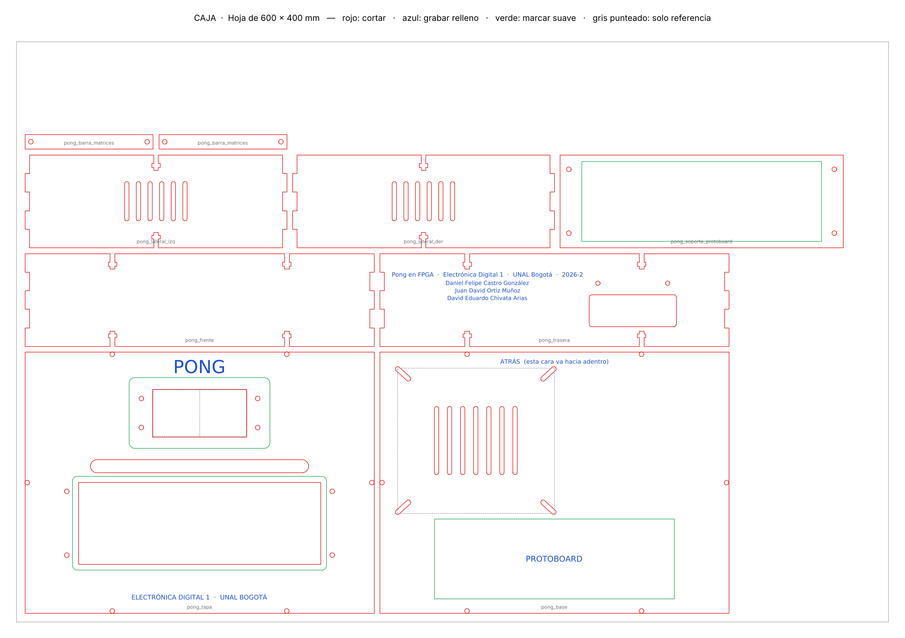

# Caja del Pong para corte láser

Aquí están los archivos para cortar en láser la caja del Pong y las dos cajitas de los controles. Están en **DXF**, que AutoCAD abre directo, y también LightBurn, RDWorks, CorelDRAW e Illustrator, o sea lo que usan casi todos los locales de corte. Si el local pide **DWG**, se abre el DXF en AutoCAD y se hace *Guardar como → DWG*.


## La idea: el montaje en protoboard va tal cual

Al final el montaje queda en protoboard (nos dijeron que se vale), así que diseñamos la caja para meter las protos sin desarmar nada:

* **La protoboard de los botones y el marcador va encajada en la tapa, a ras.** Queda dentro de la caja, pero con la cara de arriba al nivel de la tapa, así que se pueden presionar los pulsadores y ver los displays. Por debajo la sostiene una lámina de MDF colgada de cuatro tornillos.
* **Detrás de esa protoboard hay una ranura de 150 × 9 mm** por donde bajan los cables hacia la tarjeta.
* **Las dos matrices 8×8 se asoman por su ventana** (64,8 × 32,8 mm) y las aprietan por detrás dos barras atornilladas.
* **Adentro, sobre la base:** la A-C4E6E10 atrás a la izquierda, en separadores, y una protoboard completa adelante (la de las matrices y, más adelante, los receptores RF). Su sitio queda marcado en la base.
* **Atrás:** una salida para el USB y el USB-Blaster justo detrás de la tarjeta, dos huecos para las antenas y los nombres grabados.

Si más adelante pasamos todo a baquela con pulsadores de panel, está la versión anterior (ventanas para los displays y botones de 12 mm) en `variantes/parametros_tapa_con_pulsadores.json`.

## Qué hay en la carpeta

| Archivo | Para qué |
|---|---|
| `dxf/hojas_para_laser/hoja_1_caja_600x400mm.dxf` | **Lo que se manda a cortar ya.** Las 9 láminas de la caja en una hoja de 600 × 400 mm. |
| `dxf/hojas_para_laser/hoja_2_controles_600x400mm.dxf` | Las cajitas de los controles J1 y J2. Se cortan **cuando el circuito inalámbrico esté listo** y sepamos su tamaño. |
| `dxf/piezas/*.dxf` | Cada pieza suelta, por si el local las quiere acomodar a su manera o toca repetir una. |
| `dxf/guia_con_referencias/` | Las mismas hojas con nombres y contornos de referencia en gris. **No se mandan al láser.** |
| `pdf/plantillas_1a1_carta.pdf` | Tapa, tapa de un control y base a escala real, en hoja carta. |
| `parametros_caja.json` | Todas las medidas. Si algo no cuadra se cambia aquí. |
| `generar_caja.py`, `verificar_caja.py`, `renderizar_caja.py` | Generan, revisan y dibujan todo. |



## Antes de mandar a cortar: medir esto

| Qué medir | Valor que usamos | Parámetro |
|---|---|---|
| Protoboard (largo × ancho × alto, **sin** las pestañitas de los lados) | 165 × 55 × 8,5 mm | `proto_ancho`, `proto_fondo`, `proto_alto` |
| Tamaño de la tarjeta A-C4E6E10 | 108 × 100 mm (sacado de foto) | `tarjeta_ancho`, `tarjeta_fondo` |
| Lado de cada matriz (la pieza negra) | 32 mm | `matriz_lado` |
| ¿Las dos matrices quedan pegadas o con espacio? | pegadas | `matriz_separacion` |
| Espesor real del MDF (a veces es 2,7 o 3,2) | 3,0 mm | `material_espesor` |
| Kerf del láser del local | 0,15 mm | `kerf` |

La forma más fácil es imprimir `pdf/plantillas_1a1_carta.pdf` **al 100 %** (sin "ajustar a la página"), revisar con regla que la barra mida 50 mm y poner encima la protoboard y las matrices. Si caen en su hueco, se corta.

Para regenerar todo después de cambiar una medida:

```bash
cd caja
pip install ezdxf shapely matplotlib trimesh mapbox_earcut
python3 generar_caja.py      # DXF
python3 verificar_caja.py    # revisiones (todo debe decir PASA)
python3 renderizar_caja.py   # imágenes y plantillas
```

`verificar_caja.py` revisa:

* que los dedos de todas las esquinas encajen;
* que cada tornillo de la tapa y de la base caiga sobre su ranura en T;
* que entre cortes queden al menos 2 mm de material;
* que la tarjeta y la protoboard de adentro no se monten una sobre otra;
* que la proto de la tapa quede completa sobre su lámina y con los cuatro tornillos alineados;
* que entre la proto de adentro (con los cables parados) y la de arriba queden casi 3 cm.

Al final da los metros de corte para cotizar: unos 8 m para la caja y 4,5 m para los controles.

## Qué decirle al local de corte

* Material: **MDF de 3 mm**.
* Capa **CORTE** (rojo): corte pasante. Capa **GRABADO** (azul): grabado relleno. Capa **MARCADO** (verde): línea suave sin atravesar.
* Que graben primero y corten después, y que corten los huecos interiores antes que el contorno.
* La compensación del kerf (0,15 mm) ya viene en el archivo.

## Materiales para armar

| Cantidad | Qué |
|---|---|
| 1 hoja | MDF 3 mm de 60 × 40 cm (otra igual cuando toque cortar los controles) |
| 12 + 12 | Tornillos M3 × 12 mm + tuercas M3 para tapa y base |
| 4 | Separadores M3 de 12 mm + 8 tornillos M3 × 6 para la tarjeta |
| 4 | Tornillos M3 × 20 mm con 3 tuercas cada uno para colgar la lámina de la protoboard |
| 4 | Tornillos M3 × 20 mm con 2 tuercas cada uno para las barras de las matrices |
| — | Colbón, silicona caliente y cinta doble faz |

## Orden de armado

1. **Probar en seco** una esquina (frente con un lateral): debe entrar apretada sin martillo.
2. **Pegar las cuatro paredes** con colbón. La tapa va encima sin tornillos como plantilla para que todo quede a escuadra, y se deja secar unos 30 minutos.
3. **Meter las 12 tuercas** en los bolsillos de las ranuras en T, sostenidas con un pedacito de cinta.
4. **Base:** los separadores y la tarjeta en las ranuras diagonales, con "ATRÁS" hacia la pared de la salida de cables. La protoboard de adentro va pegada con su adhesivo en el rectángulo marcado.
5. **Tapa, protoboard:**
   * Se pasan los 4 tornillos M3 × 20 por la tapa desde arriba.
   * Por debajo van dos tuercas: la primera aprieta la tapa y la segunda hace de espaciador (si falta altura, se le pone una arandela).
   * Después va la lámina de soporte y una tuerca final.
   * Hay que dejar unos 5,5 mm entre la tapa y la lámina, para que la proto (8,5 mm), pegada sobre la lámina, quede a ras con la tapa.
   * Los cables bajan por la ranura.
6. **Tapa, matrices:** desde abajo, se asoman por la ventana y se aprietan con las dos barras.
7. **Conectar, probar con la caja abierta y cerrar** con 6 tornillos arriba y 6 abajo.

**Para que nada se suelte al mover la caja:** usen cables cortos y pegados a la proto (cable UTP cortado a la medida en vez de jumpers largos), pongan una gota de silicona caliente en los conectores de la tarjeta y de las matrices, y amarren con un cintillo el cable que baja por la ranura.
