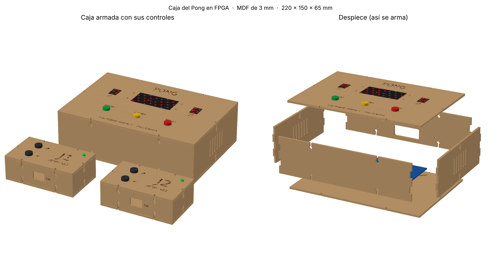
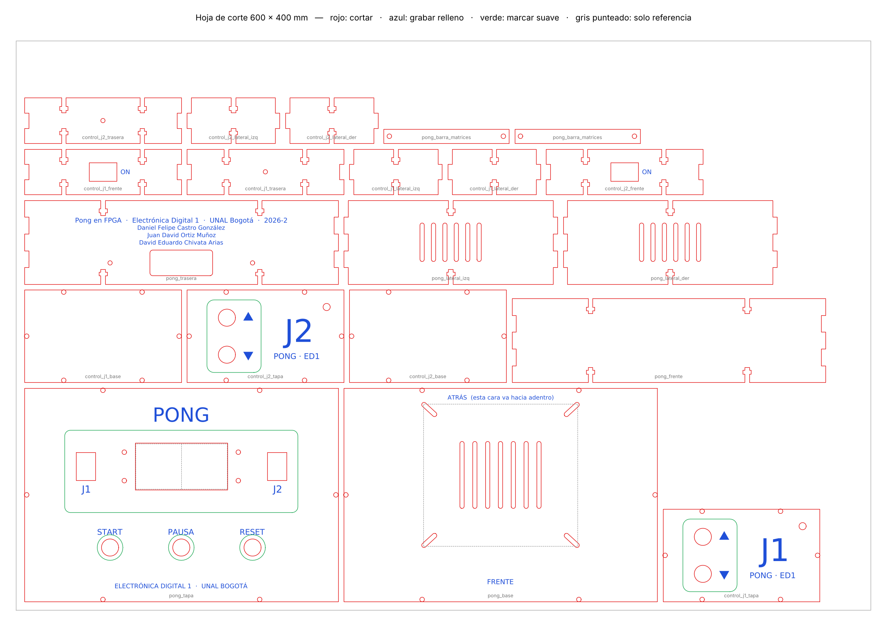

# Caja del Pong para corte láser

Aquí están los archivos para cortar en láser la caja del Pong y las dos cajitas de los controles. Están en **DXF**, que AutoCAD abre directo, y también LightBurn, RDWorks, CorelDRAW e Illustrator, o sea lo que usan casi todos los locales de corte. Si el local pide **DWG**, se abre el DXF en AutoCAD y se hace *Guardar como → DWG*, sin tocar nada más.



## Qué hay en la carpeta

| Archivo | Para qué |
|---|---|
| `dxf/hojas_para_laser/hoja_1_de_1_600x400mm.dxf` | **El que se manda a cortar.** Las 20 láminas acomodadas en una hoja de 600 × 400 mm. |
| `dxf/piezas/*.dxf` | Cada pieza suelta, por si el local prefiere acomodarlas a su manera o si toca repetir una. |
| `dxf/guia_con_referencias/hoja_1_guia.dxf` | La misma hoja con el nombre de cada pieza, el borde de la tarjeta y el de las matrices en gris. **No se manda al láser**; es para nosotros. |
| `pdf/plantillas_1a1_carta.pdf` | La tapa principal, la de un control y la base a escala real, en hoja carta. |
| `img/hoja_corte.png` | Vista previa de la hoja. |
| `parametros_caja.json` | Todas las medidas. Si algo no cuadra se cambia aquí. |
| `generar_caja.py`, `verificar_caja.py`, `renderizar_caja.py` | Los scripts que generan, revisan y dibujan todo. |



## Lo que va en cada parte

Nos basamos en el hardware de la Fase 3: pantalla de 8 × 16 con dos matrices 8×8 MAX7219, dos displays de 7 segmentos externos para el marcador, tres pulsadores (START, PAUSA y RESET), dos receptores RF y la tarjeta A-C4E6E10.

* **Tapa** (220 × 150 mm): una ventana de 64,8 × 32,8 mm para las dos matrices juntas, una ventana para el display de J1 a la izquierda y otra para el de J2 a la derecha, los tres botones de Ø12 mm abajo y el título grabado. Los cuatro agujeros alrededor de la pantalla son para las barras que sostienen las matrices por detrás.
* **Base**: cuatro ranuras en diagonal para los separadores de la tarjeta FPGA y rejillas de ventilación debajo de ella. Como todavía no tenemos la medida exacta de los agujeros de la tarjeta, hicimos ranuras en vez de huecos redondos, así el tornillo puede correrse unos 3,5 mm en cada eje.
* **Pared de atrás**: una salida de 44 × 18 mm para el cable USB/alimentación y el USB-Blaster, dos huecos de Ø3 para sacar las antenas de los receptores y los nombres del grupo grabados.
* **Laterales**: ranuras de ventilación.
* **Controles J1 y J2** (110 × 65 × 38 mm cada uno): dos botones (subir y bajar) con flechas grabadas, un LED de Ø5, el hueco para un interruptor de balancín en el frente y la salida de la antena atrás. Adentro caben una placa perforada de 5 × 7 cm y una batería de 9 V.

## Cómo se une

* **Las esquinas** van con dedos (finger joints). Encajan a presión, y con una gota de colbón quedan firmes.
* **La tapa y la base** no se pegan: van atornilladas con **M3 × 12 mm + tuerca M3** metida en una ranura en T dentro de cada pared. Así podemos abrir la caja para reprogramar o revisar cables sin dañar nada. Son 6 tornillos arriba y 6 abajo por caja.

## Antes de mandar a cortar: medir esto

Varias medidas las sacamos de fichas técnicas típicas porque los componentes todavía no están comprados. Antes de cortar hay que confirmarlas con el componente en la mano (o con la ficha de la tienda) y, si cambian, ponerlas en `parametros_caja.json`:

| Qué medir | Valor que usamos | Parámetro |
|---|---|---|
| Tamaño de la tarjeta A-C4E6E10 | 108 × 100 mm (sacado de la foto) | `tarjeta_ancho`, `tarjeta_fondo` |
| Distancia de sus agujeros al borde | 4 mm | `tarjeta_agujero_margen` |
| Lado de cada matriz 8×8 (la pieza negra) | 32 mm | `matriz_lado` |
| ¿Las matrices quedan pegadas o con espacio entre ellas? | pegadas (0 mm) | `matriz_separacion` |
| Display de 7 segmentos (0,56") | 12,6 × 19 mm | `display_ancho`, `display_alto` |
| Diámetro de la rosca de los pulsadores | Ø12 mm | `boton_diametro` |
| Interruptor de balancín (KCD11) | 19,2 × 12,8 mm | `interruptor_ancho`, `interruptor_alto` |
| Espesor real del MDF (a veces es 2,7 o 3,2) | 3,0 mm | `material_espesor` |
| Kerf del láser del local (lo saben ellos) | 0,15 mm | `kerf` |

El truco más fácil para confirmar es imprimir `pdf/plantillas_1a1_carta.pdf` **al 100 %** (sin "ajustar a la página"), revisar con regla que la barra mida 50 mm y poner encima las matrices, los displays y los botones. Si todo cae en su hueco, se corta.

Para regenerar todo después de cambiar una medida:

```bash
cd caja
pip install ezdxf shapely matplotlib trimesh mapbox_earcut
python3 generar_caja.py      # DXF
python3 verificar_caja.py    # revisiones (todo debe decir PASA)
python3 renderizar_caja.py   # imágenes y plantillas
```

`verificar_caja.py` revisa que los dedos de todas las esquinas encajen sin choques ni huecos, que los 12 tornillos de cada caja caigan sobre su ranura en T, que entre cortes vecinos queden al menos 2 mm de material, que la tarjeta quepa y que los DXF estén sanos (en milímetros y con todos los contornos de corte cerrados). Al final da los metros de corte, que es con lo que cotizan casi todos los locales (ahora mismo son unos 11 m).

## Qué decirle al local de corte

* Material: **MDF de 3 mm**. También sirve acrílico de 3 mm, aunque ahí conviene pedir la tapa en acrílico negro o humo para que las matrices se vean más.
* Capa **CORTE** (rojo): corte pasante.
* Capa **GRABADO** (azul): grabado relleno (raster). Son las letras y las flechas.
* Capa **MARCADO** (verde): línea suave sin atravesar, a baja potencia. Son los marcos decorativos.
* Que graben primero y corten después, y que corten los huecos interiores antes que el contorno, para que la pieza no se mueva.
* La compensación del kerf (0,15 mm) ya viene en el archivo. Si su láser quema más o menos, nos dicen el valor y regeneramos.

## Materiales para armar

| Cantidad | Qué |
|---|---|
| 1 hoja | MDF 3 mm de 60 × 40 cm (o lo que tenga el local; todo cabe en esa medida) |
| 36 | Tornillos M3 × 12 mm (12 de la caja principal y 12 por cada control) |
| 36 | Tuercas M3 para las ranuras en T |
| 4 | Separadores M3 de 10 mm + 4 tornillos M3 × 6 para la tarjeta |
| 4 | Separadores M3 (de unos 12 mm; se ajustan al montar) + 8 tornillos M3 para las barras de las matrices |
| 3 + 4 | Pulsadores de panel de 12 mm (3 en la caja y 2 por control) |
| 2 | Interruptores de balancín KCD11 y LEDs de 5 mm para los controles |
| — | Colbón o pegante para madera en las esquinas, cinta doble faz para las placas perforadas |

## Orden de armado

1. Pegar las cuatro paredes por los dedos y dejar secar escuadradas, con la tapa encima **sin tornillos** para que sirva de plantilla.
2. Meter las tuercas en los bolsillos de las ranuras en T (un poco de cinta las sostiene mientras se atornilla).
3. Atornillar la tarjeta a la base con los separadores, con el texto "ATRÁS" hacia la pared de los cables.
4. Montar en la tapa las matrices desde abajo (que se asomen por la ventana), apretarlas con las dos barras, y luego los displays y los botones.
5. Conectar todo, cerrar con la base y la tapa, y probar.
