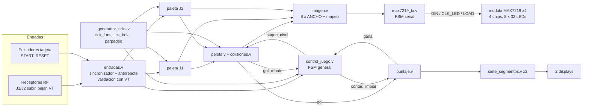
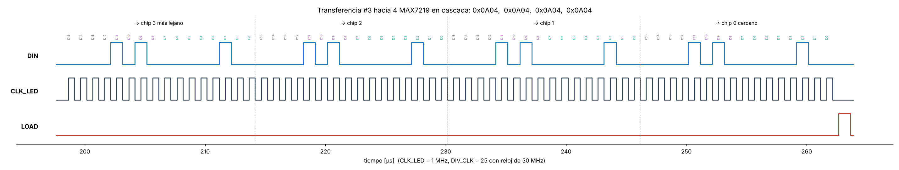

# Diseño lógico por bloques (Fases 1 y 2)

Este documento reúne las **fichas de bloque** de la Sección XIV de nuestra guía metodológica. La idea es que cada módulo de Verilog tenga detrás su tabla, sus ecuaciones y su prueba, y que nadie tenga que leer el código para entender qué hace.

Convenciones que usamos en todo el proyecto:

* **Ancho de la cancha:** `ANCHO = 32` con el módulo MAX7219 x4 (decisión D-25) o `ANCHO = 16` con dos matrices sueltas. Escribimos `U = ANCHO − 1` para la última columna y `N = ANCHO / 8` para el número de MAX7219. Todas las tablas valen para los dos casos.
* Coordenadas enteras: `0 ≤ X ≤ U` (columna), `0 ≤ Y ≤ 7` (fila, **la fila 0 es la de arriba**).
* Paleta de J1 en la columna 0 y de J2 en la columna U, descrita por su fila superior `YP` y su longitud `LP = 3`.
* `DX = 1`: la pelota va hacia J2 (derecha). `DY = 1`: la pelota baja.
* En las ecuaciones, `A'` es el complemento de `A`, `·` es AND y `+` es OR.
* Todas las señales internas son **activas en alto**; la polaridad física se resuelve en los bordes del diseño.
* Un solo reloj, `CLK_SYS` = 50 MHz. Todo lo "lento" se hace con pulsos de habilitación de un ciclo.

## Arquitectura (Fase 1)



### Anchos de registro

Los anchos salen del rango que tiene que representar cada variable, no de la intuición:

| Variable | Rango | Valores | Bits | Comentario |
|----------|-------|---------|------|------------|
| `X` | 0..U | 32 (o 16) | 5 (o 4) | ⌈log₂ 32⌉ = 5; el parámetro `XB` se calcula solo |
| `Y` | 0..7 | 8 | 3 | |
| `YP1`, `YP2` | 0..5 | 6 | 3 | 8 − LP = 5; los códigos 6 y 7 se tratan como inválidos |
| `DX`, `DY` | ±1 | 2 | 1 + 1 | |
| `P1`, `P2` | 0..9 | 10 | 4 | un display por jugador |
| `estado` | 5 estados | 5 | 3 | 101, 110 y 111 sin usar → ESPERA |
| `golpes` | 0..15 | 16 | 4 | se satura en 15 |
| Trama serial | 16 · N bits | — | 64 (o 32) | registro de desplazamiento de `max7219_tx` |
| `nivel` | 0..3 | 4 | 2 | |
| Divisor de 1 ms | 0..49 999 | 50 000 | 16 (usamos 32) | dejamos 32 para simular con cualquier `CLK_HZ` |

---

## Ficha 1 · `entradas.v` + `antirrebote.v`

1. **Función:** llevar cada señal externa al dominio de `CLK_SYS`, quitar rebotes y anular las órdenes de un jugador sin enlace.
2. **Requisitos:** R01, R09.
3. **E/S:** pines crudos `J1_UP`, `J1_DOWN`, `J2_UP`, `J2_DOWN`, `J1_VT`, `J2_VT`, `START_PIN`, `RESET_PIN` (1 bit c/u) → `jX_subir`, `jX_bajar`, `enlace_jX`, `start_pulso`, `reset_juego`.
4. **Reloj/reinicio:** `CLK_SYS`; se reinicia solo con el POR (si no, RESET se reiniciaría a sí mismo).
5. **Estados:** por línea, `salida` (1 bit) y `cuenta` (8 bits) de lecturas distintas consecutivas.
6. **Tabla de transición del antirrebote** (se evalúa con cada `tick_1ms`):

   | `lógica == salida` | `cuenta ≥ N−1` | `salida⁺` | `cuenta⁺` |
   |:---:|:---:|:---:|:---:|
   | 1 | x | salida | 0 |
   | 0 | 0 | salida | cuenta + 1 |
   | 0 | 1 | lógica | 0 |

7. **Ecuaciones** (por jugador): `subir = U_limpio · enlace`, `bajar = D_limpio · enlace`, con `enlace = VT_limpio` si `USAR_VT = 1` y `enlace = 1` si no. `start_pulso = salida · salida_anterior'`.
8. **Diagrama:** pin → FF → FF → (inversión opcional) → contador de coincidencias → salida.
9. **Pruebas:** rebotes de 3 ms / 2 ms no pasan; pulsación estable pasa a los 8 ms; hueco de VT de 3 ms no corta el enlace; pérdida de VT con dato enclavado en 1 anula la orden; START con rebotes da un solo pulso.
10. **Archivos:** `rtl/entradas.v`, `rtl/antirrebote.v`, `tb/tb_entradas.v`.
11. **Resultado:** `tb_entradas` **PASA** (ver `sim/logs/tb_entradas.log`).

---

## Ficha 2 · `paletas.v` (módulo `paleta`)

1. **Función:** posición vertical de una paleta.
2. **Requisitos:** R01, R02.
3. **E/S:** `subir`, `bajar`, `habilitar`, `tick_1ms` → `yp[2:0]`.
4. **Reloj/reinicio:** `CLK_SYS`; `yp = 2` al reiniciar.
5. **Estados:** `yp`, `m_anterior[1:0]`, `cuenta_rep[15:0]`.
6. **Tabla de verdad de la petición** (Tabla V de la guía):

   | U | D | M1 M0 | Acción |
   |:-:|:-:|:-----:|--------|
   | 0 | 0 | 00 | mantener |
   | 0 | 1 | 01 | bajar |
   | 1 | 0 | 10 | subir |
   | 1 | 1 | 00 | mantener (conflicto) |

   **Tabla de transición de posición** (cuando hay `paso` y `habilitar`):

   | M1 M0 | Condición de borde | `YP⁺` |
   |:-----:|--------------------|-------|
   | 10 | `YP > 0` | `YP − 1` |
   | 10 | `YP = 0` | `YP` |
   | 01 | `YP < 5` | `YP + 1` |
   | 01 | `YP = 5` | `YP` |
   | 00 | — | `YP` |
   | — | `YP > 5` (inválido) | `5` |

7. **Ecuaciones:**
   * `M1 = U·D'`, `M0 = U'·D`
   * `puede_subir = (YP ≠ 0) = YP2 + YP1 + YP0`
   * `puede_bajar = (YP < 5) = YP2' + YP1'·YP0'`
   * `paso = (M ≠ 00)·(M ≠ M_anterior) + (M ≠ 00)·(M = M_anterior)·tick_1ms·(cuenta_rep ≤ 1)`

   Con esto el pulso `paso` hace el papel del `TICK_PADDLE` de la guía, pero sin perder toques cortos (decisión D-03).
8. **Diagrama:** petición combinacional → generador de paso (autorrepetición 180 ms / 90 ms) → registro `YP` con saturación.
9. **Pruebas (T01, T02):** toque de un jugador mueve solo su paleta; dos jugadores a la vez; U = D = 1 durante 400 ms no mueve; mantener subir 1,5 s deja `YP = 0`; mantener bajar 2 s deja `YP = 5`; tiempos de autorrepetición medidos (180 ms y 90 ms); `habilitar = 0` congela; reinicio en medio de una pulsación. Un monitor revisa en **cada ciclo** que `YP ≤ 5` y que nunca salte más de una fila.
10. **Archivos:** `rtl/paletas.v`, `tb/tb_paletas.v`.
11. **Resultado:** `tb_paletas` **PASA**.

---

## Ficha 3 · `colisiones.v` (combinacional) y `pelota.v` (registro)

1. **Función:** `colisiones` calcula el siguiente `(X, Y, DX, DY)` y los eventos; `pelota` lo guarda en cada `tick_bola`.
2. **Requisitos:** R03, R04, R05.
3. **E/S:** `x[3:0]`, `y[2:0]`, `dx`, `dy`, `yp1`, `yp2` → `x_sig`, `y_sig`, `dx_sig`, `dy_sig`, `impacto_izq`, `impacto_der`, `gol_j1`, `gol_j2`, `rebote_pared`, `fuera`.
4. **Reloj/reinicio:** `pelota` en `CLK_SYS`; reposo en `X = ANCHO/2 − 1, Y = 3, DX = 1, DY = 1`.
5. **Estados:** `X`, `Y`, `DX`, `DY` (9 bits en total).
6. **Condiciones booleanas:**

   ```
   cubre1       = (YP1 ≤ Y) · (Y ≤ YP1 + 2)
   cubre2       = (YP2 ≤ Y) · (Y ≤ YP2 + 2)
   borde_izq    = (X = 1)  · DX'
   borde_der    = (X = U−1) · DX
   impacto_izq  = borde_izq · cubre1
   impacto_der  = borde_der · cubre2
   gol_j2       = borde_izq · cubre1'          (J1 falló)
   gol_j1       = borde_der · cubre2'          (J2 falló)
   fuera        = (X = 0) + (X = U)
   ```

   **Prioridades** cuando varias cosas pasan en el mismo paso:
   1. Primero lo horizontal (impacto o gol), porque decide si la pelota sigue en juego.
   2. Si hubo impacto, el efecto por zona puede cambiar `DY` (D-05):
      `DY_ef = 0` si `Y = YP` (fila superior), `1` si `Y = YP + 2` (fila inferior), `DY` si golpea en el centro.
   3. Al final el rebote con techo o piso sobre `DY_ef`:
      `choca_techo = (Y = 0)·DY_ef'`, `choca_piso = (Y = 7)·DY_ef`.

   **Tabla de eventos** (resumen; `tb_colisiones` la recorre completa: 36 864 casos con 32 columnas y 18 432 con 16):

   | Situación | `X⁺` | `DX⁺` | `Y⁺` / `DY⁺` | Evento |
   |-----------|------|-------|--------------|--------|
   | En juego, lejos de bordes | X ± 1 | DX | Y ± 1 (con rebote si toca techo/piso) | `rebote_pared` si aplica |
   | `X = 1`, `DX = 0`, paleta cubre | 2 | 1 | según zona + paredes | `impacto_izq` |
   | `X = 1`, `DX = 0`, paleta no cubre | 0 | 0 | Y ± 1 | `gol_j2` |
   | `X = U−1`, `DX = 1`, paleta cubre | U−2 | 0 | según zona + paredes | `impacto_der` |
   | `X = U−1`, `DX = 1`, paleta no cubre | U | 1 | Y ± 1 | `gol_j1` |
   | `X = 0` o `X = U` | X | DX | Y / DY | `fuera` (congelada) |

   **Tabla de transición del registro** (`pelota.v`):

   | rst | saque | tick · habilitar | Siguiente estado |
   |:---:|:-----:|:----------------:|------------------|
   | 1 | x | x | reposo |
   | 0 | 1 | x | saque: `X = ANCHO/2 − 1` si sale a la derecha, `X = ANCHO/2` si sale a la izquierda |
   | 0 | 0 | 1 | salida de `colisiones` |
   | 0 | 0 | 0 | se mantiene |

7. **Por qué no se cuentan goles dobles (R05):** las banderas de evento de `pelota.v` se registran y duran un solo ciclo; después del gol la pelota queda en `X = 0` o `X = U`, donde `colisiones` ya no genera eventos; y además el marcador solo cuenta en el estado JUEGO, del que la FSM sale en el ciclo siguiente al gol.
8. **Diagrama:** registro de 9 bits realimentado a través de la lógica combinacional; un multiplexor elige entre mantener, saque y siguiente.
9. **Pruebas:** `tb_colisiones` (barrido exhaustivo contra un modelo de referencia escrito de otra forma, más invariantes) y `tb_pelota` (T03: sin tick no se mueve y cada tick avanza exactamente una casilla; T04: techo, piso y ambas paletas; T05: un gol de cada lado sin repetir; prioridad del saque; y 6000 pasos aleatorios contra el modelo con conteo goles = escapes).
10. **Archivos:** `rtl/colisiones.v`, `rtl/pelota.v`, `tb/tb_colisiones.v`, `tb/tb_pelota.v`, `tb/modelo_referencia.vh`.
11. **Resultado:** ambos **PASAN** con 32 y con 16 columnas.

---

## Ficha 4 · `puntaje.v`

1. **Función:** marcador 0-9 de cada jugador y detección de victoria.
2. **Requisitos:** R05, R06.
3. **E/S:** `gol_j1`, `gol_j2`, `contar`, `limpiar` → `p1[3:0]`, `p2[3:0]`, `gana_j1`, `gana_j2`.
4. **Reloj/reinicio:** `CLK_SYS`; 0-0 con `rst` o `limpiar`.
5. **Estados:** `P1`, `P2`.
6. **Tabla de transición** (para cada jugador i):

   | rst + limpiar | contar · gol_i | P_i < 9 | `P_i⁺` |
   |:---:|:---:|:---:|:---:|
   | 1 | x | x | 0 |
   | 0 | 1 | 1 | P_i + 1 |
   | 0 | 1 | 0 | P_i (saturado) |
   | 0 | 0 | x | P_i |

7. **Ecuaciones:** `inc_i = contar · gol_i · (P_i < 9)`, `gana_i = (P_i ≥ 9)`. Para 4 bits, `(P ≥ 9) = P3·(P2 + P1 + P0)`.
8. **Diagrama:** dos contadores de 4 bits con habilitación, borrado síncrono y comparador.
9. **Pruebas (T05, T06):** gol de cada jugador, gol con `contar = 0`, saturación en 9, `limpiar` y `rst` a mitad de partida.
10. **Archivos:** `rtl/puntaje.v`, `tb/tb_puntaje.v`.
11. **Resultado:** **PASA**.

---

## Ficha 5 · `control_juego.v` (FSM general)

1. **Función:** decide en qué momento del juego estamos y genera saques, limpieza del marcador y nivel de velocidad.
2. **Requisitos:** R05, R06, R09.
3. **E/S:** `start`, `enlace_ok`, `gol_j1`, `gol_j2`, `gana_j1`, `gana_j2`, `rebote_paleta`, `tick_1ms` → `estado[2:0]`, `mover_pelota`, `contar`, `paletas_hab`, `saque`, `saque_dx`, `saque_dy`, `saque_y`, `limpiar`, `nivel[1:0]`, `ganador`.
4. **Reloj/reinicio:** `CLK_SYS`; reinicio → ESPERA.
5. **Codificación:** binaria de 3 bits.

   | Estado | Código | `mover_pelota` | `contar` | `paletas_hab` |
   |--------|:------:|:---:|:---:|:---:|
   | ESPERA | 000 | 0 | 0 | 1 |
   | JUEGO | 001 | 1 | 1 | 1 |
   | PUNTO | 010 | 0 | 0 | 1 |
   | PAUSA | 011 | 0 | 0 | 0 |
   | FIN | 100 | 0 | 0 | 0 |
   | (sin usar) | 101-111 | → ESPERA | | |

6. **Diagrama de estados:**

   ```mermaid
   stateDiagram-v2
       [*] --> ESPERA : RESET / POR
       ESPERA --> JUEGO : START · enlace_ok
       JUEGO --> PUNTO : gol_j1 + gol_j2, prioridad 1
       JUEGO --> PAUSA : sin enlace, prioridad 2
       JUEGO --> PAUSA : START, prioridad 3
       PAUSA --> JUEGO : START · enlace_ok
       PUNTO --> FIN : 1 s cumplido y alguien llegó a 9
       PUNTO --> JUEGO : 1 s cumplido / saque hacia quien perdió
       FIN --> ESPERA : START / limpiar + saque
   ```

   **Tabla de transición:**

   | Estado | Condición (en orden de prioridad) | Siguiente | Acción en la transición |
   |--------|-----------------------------------|-----------|-------------------------|
   | ESPERA | `START · enlace_ok` | JUEGO | — |
   | JUEGO | `gol_j1 + gol_j2` | PUNTO | guardar quién perdió |
   | JUEGO | `enlace_ok'` | PAUSA | — |
   | JUEGO | `START` | PAUSA | — |
   | PUNTO | `espera_cumplida · (gana_j1 + gana_j2)` | FIN | guardar ganador |
   | PUNTO | `espera_cumplida` | JUEGO | `saque`, `saque_dx = perdió_J2` |
   | PAUSA | `START · enlace_ok` | JUEGO | — |
   | FIN | `START` | ESPERA | `limpiar`, `saque` |
   | 101-111 | siempre | ESPERA | — |

7. **Ecuaciones de salida (Moore):** `mover_pelota = contar = E2'·E1'·E0`, `paletas_hab = E2'·(E1'+E0')`. Nivel: `nivel = 3` si `golpes ≥ 9`, `2` si `≥ 6`, `1` si `≥ 3`, `0` si no.
8. **Prioridades especiales:** el gol le gana a la pérdida de enlace en el mismo ciclo; si no, el punto se perdería al pasar a PAUSA.
9. **Pruebas:** recorrido de todas las filas de la tabla, arranque sin enlace, prioridad gol/enlace, temporización de la pausa del punto, dirección del saque, recuperación desde 101, 110 y 111 (forzando el registro) y RESET a mitad de juego.
10. **Archivos:** `rtl/control_juego.v`, `tb/tb_control_juego.v`.
11. **Resultado:** **PASA**.

---

## Ficha 6 · `generador_ticks.v`

1. **Función:** bases de tiempo.
2. **Requisitos:** R03.
3. **E/S:** `nivel[1:0]`, `sincronizar` → `tick_1ms`, `tick_bola`, `parpadeo`.
4. **Reloj/reinicio:** `CLK_SYS`.
5. **Estados:** tres contadores.
6. **Tabla de periodos:**

   | Señal | Periodo | Ciclos a 50 MHz |
   |-------|---------|-----------------|
   | `tick_1ms` | 1 ms | 50 000 |
   | `tick_bola`, nivel 0 | 170 ms (260 con 16 col.) | 8 500 000 |
   | `tick_bola`, nivel 1 | 130 ms (200) | 6 500 000 |
   | `tick_bola`, nivel 2 | 100 ms (150) | 5 000 000 |
   | `tick_bola`, nivel 3 | 75 ms (110) | 3 750 000 |
   | `parpadeo` (medio periodo) | 250 ms | 12 500 000 |

7. **Detalle:** `sincronizar` (fuera de JUEGO) mantiene en cero el contador de la pelota, así el primer paso después de un saque o una pausa siempre llega un periodo completo después.
8. **Pruebas:** periodos medidos en ciclos para cada nivel, pulsos de un ciclo, efecto de `sincronizar` y parpadeo.
9. **Archivos:** `rtl/generador_ticks.v`, `tb/tb_generador_ticks.v`.
10. **Resultado:** **PASA**.

---

## Ficha 7 · `imagen.v`

1. **Función:** construir la imagen 8 × ANCHO, reordenarla según cómo estén soldadas las matrices y generar el patrón de calibración.
2. **Requisito:** R07.
3. **E/S:** `x`, `y`, `yp1`, `yp2`, `mostrar_pelota`, `modo_fin`, `ganador`, `parpadeo`, `modo_prueba` → `img[8·ANCHO−1:0]`, `bytes[8·ANCHO−1:0]` (256 bits con el módulo x4).
4. Combinacional.
5. **Regla de encendido:**

   ```
   pixel(f, c) = (c = 0)·(YP1 ≤ f ≤ YP1+2)
               + (c = U)·(YP2 ≤ f ≤ YP2+2)
               + mostrar_pelota·(c = X)·(f = Y)
               + modo_fin·parpadeo·[ganador'·(c < ANCHO/2) + ganador·(c ≥ ANCHO/2)]
   img[ANCHO·f + c] = modo_prueba ? prueba(f, c) : pixel(f, c)

   prueba(f, c) = (f = 0)·(c mod 8 ≤ ⌊c/8⌋ + 1) + (c mod 8 = 0)·(f ≤ 2)
   ```

   El patrón de prueba dibuja una "Γ" por matriz, con la esquina arriba a la izquierda, un brazo vertical de 3 LEDs y uno horizontal de (número de matriz + 2) LEDs. Se ve mientras se sostiene RESET (D-27):

   ```
   +--------------------------------+
   |OO......OOO.....OOOO....OOOOO...|
   |O.......O.......O.......O.......|
   |O.......O.......O.......O.......|
   |................................|
   |................................|
   |................................|
   |................................|
   |................................|
   +--------------------------------+
   ```

   Si una matriz se ve girada o en espejo, o los brazos no crecen de izquierda a derecha, se corrige con los parámetros de mapeo y con `MODULO_CERCANO`.

6. **Mapeo de bits** (por defecto): el byte del dígito `d` del módulo `m` es la fila `d`, y su bit 7 es la columna izquierda del módulo:

   `bytes[8·(8m + d) + b] = img[ANCHO·d + 8m + (7 − b)]`

   | Matriz | Columnas | Posición en la cadena (`MODULO_CERCANO = 0`) | (`MODULO_CERCANO = 1`) |
   |--------|----------|-----------------------------------------------|------------------------|
   | 0 | 0-7 (lado J1) | chip 0, conectado a DIN de la FPGA | chip 3 (el más lejano) |
   | 1 | 8-15 | chip 1 | chip 2 |
   | 2 | 16-23 | chip 2 | chip 1 |
   | 3 | 24-31 (lado J2) | chip 3 (el más lejano) | chip 0, conectado a DIN |

   Con `TRANSPONER`, `INV_BITS` e `INV_DIGITOS` se cubren las 8 orientaciones posibles del módulo sin tocar la lógica.
7. **Pruebas (T07):** todas las escenas posibles de pelota y paletas (9216 con 32 columnas), todos los LEDs cada vez; el mapeo por defecto y uno alterno; el patrón de calibración.
8. **Archivos:** `rtl/imagen.v`, `tb/tb_imagen.v`.
9. **Resultado:** **PASA**.

---

## Ficha 8 · `max7219_tx.v`

1. **Función:** enviar configuración e imagen a los `N` MAX7219 en cascada (4 en el módulo x4).
2. **Requisito:** R08.
3. **E/S:** `bytes[64·N−1:0]` → `DIN`, `CLK_LED`, `LOAD`.
4. **Reloj/reinicio:** `CLK_SYS`; solo el POR lo reinicia (RESET del juego no apaga la pantalla).
5. **Registros del MAX7219 que usamos:**

   | Dirección | Registro | Valor | Para qué |
   |:---------:|----------|:-----:|----------|
   | 0x0F | Display test | 0x00 | apagar el modo de prueba |
   | 0x0B | Scan limit | 0x07 | barrer las 8 filas |
   | 0x09 | Decode mode | 0x00 | LEDs sueltos, sin BCD |
   | 0x0A | Intensity | 0x04 | brillo moderado |
   | 0x0C | Shutdown | 0x01 | operación normal |
   | 0x01-0x08 | Dígitos 0-7 | imagen | una fila por dígito |

   **Trama de 16·N bits** (64 con el módulo x4): `{palabra_chip_N−1, …, palabra_chip_1, palabra_chip_0}`, MSB primero, donde el chip 0 es el conectado a DIN. Lo primero que sale termina en el chip más lejano. Cada palabra es `{4'h0, dirección[3:0], dato[7:0]}`.

6. **FSM del transmisor:**

   ```mermaid
   stateDiagram-v2
       [*] --> CARGA
       CARGA --> BAJO : sr ← trama, DIN ← bit 31
       BAJO --> ALTO : medio periodo / CLK_LED ← 1
       ALTO --> BAJO : medio periodo y quedan bits / CLK_LED ← 0, DIN ← siguiente bit
       ALTO --> CIERRE : medio periodo y último bit / CLK_LED ← 0
       CIERRE --> LATCH : medio periodo / LOAD ← 1
       LATCH --> SEPARA : dos medios periodos / LOAD ← 0
       SEPARA --> CARGA : medio periodo / idx ← siguiente
   ```

   Secuencia de `idx`: `0 → 1 → 2 → 3 → 4 → 5 → … → 12 → 5 → … → 12 → …`; cada 256 pantallas vuelve a `0` para repetir la configuración (D-17).

7. **Cronograma:** una transferencia real tomada del VCD de la simulación (`scripts/cronograma_max7219.py`):

   

   Es la palabra de brillo `0x0A04` enviada a los cuatro chips del módulo x4. DIN cambia cuando CLK_LED **baja** y el chip lo lee cuando CLK_LED **sube**: medio periodo (500 ns) de setup contra los 25 ns que pide la hoja de datos. LOAD sube medio periodo después del último flanco.

   Tiempo por pantalla con 4 chips: 8 × (64 × 1 µs + 2 µs) ≈ 528 µs → unas 1900 pantallas por segundo (272 µs y ~3600 con 2 chips).

8. **Pruebas (T08):** `N` modelos de MAX7219 en cadena escritos desde la hoja de datos; configuración en todos los chips; 16·N bits exactos entre LOAD; cinco patrones conocidos (uno con un LED distinto por matriz para detectar errores de orden) reconstruidos desde los registros; recuperación tras un "reinicio" simulado del chip más lejano; ambos valores de `MODULO_CERCANO`; cero violaciones de tiempo.
9. **Archivos:** `rtl/max7219_tx.v`, `tb/modelo_max7219.v`, `tb/tb_max7219.v`.
10. **Resultado:** **PASA**.

---

## Ficha 9 · `siete_segmentos.v`

1. **Función:** decodificador BCD a siete segmentos para el marcador.
2. **Requisito:** R06.
3. **E/S:** `valor[3:0]`, `apagar` → `seg[6:0] = {g, f, e, d, c, b, a}`.
4. Combinacional.
5. **Tabla de verdad** (lógica positiva):

   | Valor | g f e d c b a |
   |:-----:|:-------------:|
   | 0 | 0 1 1 1 1 1 1 |
   | 1 | 0 0 0 0 1 1 0 |
   | 2 | 1 0 1 1 0 1 1 |
   | 3 | 1 0 0 1 1 1 1 |
   | 4 | 1 1 0 0 1 1 0 |
   | 5 | 1 1 0 1 1 0 1 |
   | 6 | 1 1 1 1 1 0 1 |
   | 7 | 0 0 0 0 1 1 1 |
   | 8 | 1 1 1 1 1 1 1 |
   | 9 | 1 1 0 1 1 1 1 |
   | 10-15 | 1 0 0 0 0 0 0 (guion: señal de error) |

6. **Ecuaciones mínimas** (suma de productos, con `V = V3 V2 V1 V0` y las filas 10-15 **especificadas** como guion, no como "no importa"):

   ```
   a = V3'·V1 + V3'·V2·V0 + V3·V2'·V1' + V3'·V2'·V0'
   b = V2'·V1' + V3'·V2' + V3'·V1·V0 + V3'·V1'·V0'
   c = V3'·V0 + V3'·V2 + V2'·V1'
   d = V3'·V1·V0' + V3'·V2'·V1 + V3·V2'·V1' + V3'·V2'·V0' + V3'·V2·V1'·V0
   e = V3'·V1·V0' + V2'·V1'·V0'
   f = V3'·V2·V0' + V3'·V2·V1' + V3·V2'·V1' + V3'·V1'·V0'
   g = V3 + V1·V0' + V2'·V1 + V2·V1'
   ```

   Si tratáramos 10-15 como "no importa" las ecuaciones serían más cortas, pero preferimos que un valor imposible se vea en el display.

   Salida física: `seg = ACTIVO_BAJO ? (patrón·apagar')' : patrón·apagar'`.
7. **Pruebas:** las 16 entradas en ambas polaridades y `apagar`; el log dibuja cada dígito en ASCII.
8. **Archivos:** `rtl/siete_segmentos.v`, `tb/tb_siete_segmentos.v`.
9. **Resultado:** **PASA**.

---

## Ficha 10 · `pong_top.v`

1. **Función:** interconexión, POR de 255 ciclos, LEDs de estado de la tarjeta y selección de periodos según `ANCHO`.
2. **Requisitos:** todos.
3. **E/S físicas:**

   | Puerto | Dir. | Ancho | Descripción |
   |--------|:----:|:-----:|-------------|
   | `CLK_SYS` | in | 1 | oscilador de 50 MHz |
   | `RESET_PIN`, `START_PIN` | in | 1 | pulsadores de la tarjeta (activos en bajo) |
   | `J1_UP`, `J1_DOWN`, `J2_UP`, `J2_DOWN` | in | 1 | datos del receptor RF |
   | `J1_VT`, `J2_VT` | in | 1 | transmisión válida del HT12D |
   | `DIN`, `CLK_LED`, `LOAD` | out | 1 | hacia el módulo MAX7219 x4 (vía SN74AHCT125); LOAD va al pin CS |
   | `SEG_J1`, `SEG_J2` | out | 7 | displays `{g..a}` |
   | `LED` | out | 4 | `[0]` jugando, `[1]` pausa, `[2]` enlace J1, `[3]` enlace J2 |

4. **Pruebas:** `tb_integracion` juega una partida entera de extremo a extremo.
5. **Resultado:** **PASA** (ver `docs/verificacion.md`).
