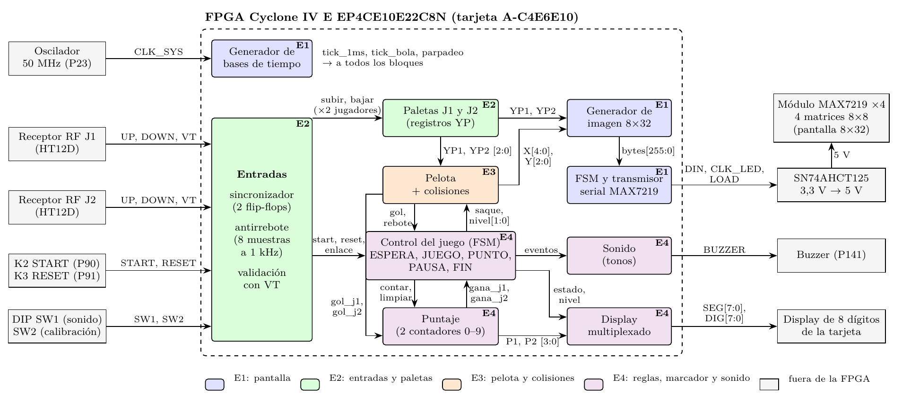
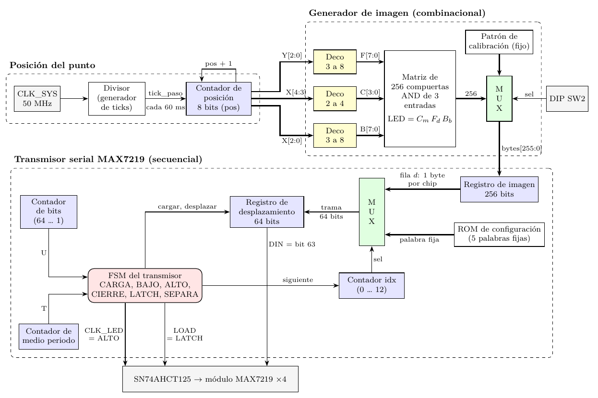
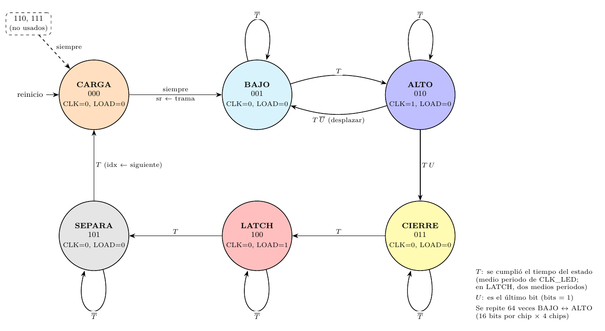
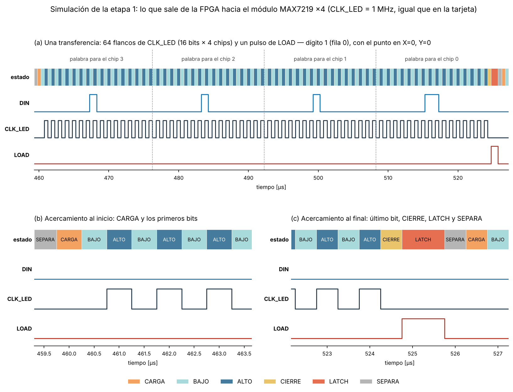
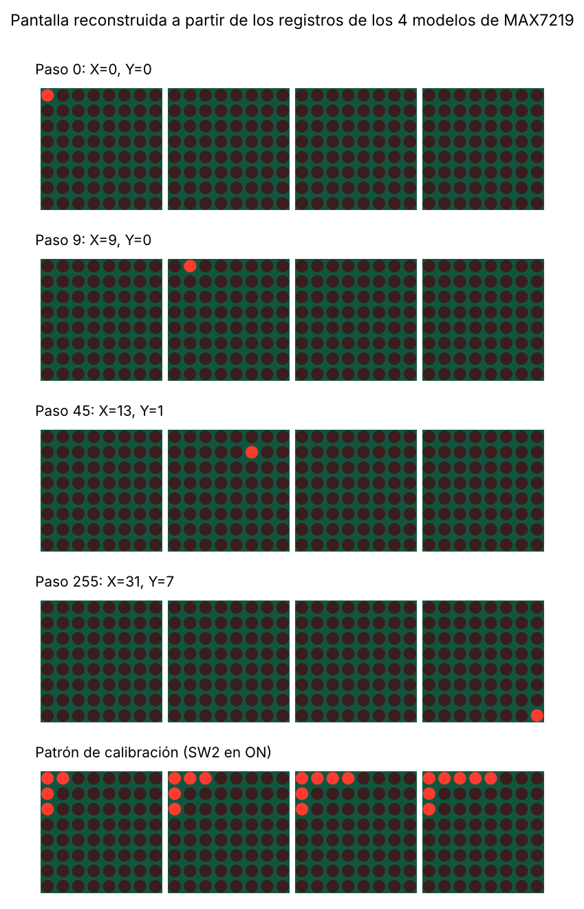

# Pong en FPGA, paso a paso — Etapa 1: la pantalla

**Electrónica Digital 1 · Universidad Nacional de Colombia, Sede Bogotá**\
Daniel Felipe Castro González · Juan David Ortiz Muñoz · David Eduardo Chivata Arias

---

Bueno, la idea de este documento es que no nos toque tragarnos el proyecto entero de una, sino irlo armando por partes. Eso fue lo que dijo el profe: **primero la estructura del circuito, después meterle código y ahí sí ponernos a trabajar** con tablas de verdad, ecuaciones y simulación, bloque por bloque.

Arrancamos por la pantalla por dos razones. Es lo que más se ve el día de la presentación, y es lo que más nos puede hacer quedar mal si no prende. Si la pantalla funciona, todo lo demás (paletas, pelota, marcador) es "solo" decidir qué LEDs prender.

Aquí va, en orden:

1. Lo que dijo el profe y cómo lo vamos a organizar.
2. La estructura del circuito (la Figura 1 nueva).
3. Cómo se maneja la pantalla.
4. La máquina de estados.
5. Tablas de verdad y ecuaciones.
6. La simulación.
7. Cómo probarlo en la tarjeta.
8. Lo que sigue.

---

## 1. Lo que dijo el profe y cómo lo vamos a organizar

El profe pidió cambiar la Figura 1 y nos dijo que para eso **no** sirven las tablas de verdad. La figura vieja era una "arquitectura funcional": cajitas con nombres, sin señales y sin saber qué sale de dónde. Lo que pide es la **estructura del circuito**:

* qué bloques hay dentro de la FPGA,
* qué señales conectan cada bloque con cuál y de cuántos bits es cada una,
* qué entra y qué sale de la FPGA, por qué pin y hacia qué periférico.

Las tablas de verdad y las ecuaciones vienen **después**, cuando ya estemos dentro de cada bloque. Por eso vamos por etapas. Cada etapa agrega unos bloques, se simula y se prueba en la tarjeta antes de pasar a la siguiente:

| Etapa | Qué agregamos | Qué se ve en la tarjeta cuando funciona |
|-------|---------------|-----------------------------------------|
| **E1 · Pantalla** | Bases de tiempo, generador de imagen y transmisor serial al MAX7219 | Un punto que recorre toda la matriz de 8 × 32 |
| E2 · Entradas y paletas | Antirrebote, validación del control RF y registros de las paletas | Las dos paletas suben y bajan con los botones |
| E3 · Pelota y colisiones | Registro de la pelota y lógica de rebotes y goles | La pelota rebota en las paredes y en las paletas |
| E4 · Reglas, marcador y sonido | FSM del juego, puntaje, display de 8 dígitos y buzzer | El juego completo |

Este documento cubre la **E1** completa: estructura, código, máquina de estados, tablas, ecuaciones y simulación.

---

## 2. Estructura del circuito (Figura 1 nueva)



*Figura 1. Estructura del circuito (nueva versión). En PDF: `docs/figuras/figura1_estructura.pdf`.*

Cómo se lee:

* **Lo gris** está por fuera de la FPGA: el oscilador, los receptores RF, los pulsadores K2 y K3, el DIP, el módulo de LEDs, el adaptador de nivel SN74AHCT125, el display de 8 dígitos y el buzzer.
* **Lo que está dentro de la línea punteada** es lo que vamos a describir en Verilog. Cada flecha lleva el nombre de la señal y, cuando es un bus, su ancho: `X[4:0]` son 5 bits porque la pelota va de la columna 0 a la 31; `bytes[255:0]` son 256 bits porque es un bit por LED.
* **Los colores** dicen en qué etapa se arma cada bloque. Lo azul (E1) es lo de este documento.

La figura está hecha en TikZ, así que se mete tal cual en el LaTeX de la guía:

* `docs/figuras/figura1_tikz.tex`: el dibujo.
* `docs/figuras/figura1_para_la_guia.tex`: el bloque `figure*` con el pie de figura, listo para pegar donde estaba la figura vieja.
* `docs/figuras/figura1_estructura.pdf`: por si se prefiere meter como imagen.

---

## 3. Cómo se maneja la pantalla

### 3.1 Lo que hay que saber del módulo

El módulo que compramos (MAX7219 ×4) son **cuatro matrices de 8 × 8 con un MAX7219 cada una**, ya encadenadas en la misma placa. Desde la FPGA solo se ven tres cables:

* **DIN**: los datos, bit por bit.
* **CLK**: el reloj; el chip lee DIN cada vez que CLK **sube**.
* **CS / LOAD**: cuando sube, cada chip "se queda" con lo que le llegó.

La gracia del MAX7219 es que **él se encarga de prender y apagar los LEDs** (el multiplexado). Nosotros no barremos filas ni nada de eso: solo le escribimos registros, y él los muestra.

* Cada chip tiene **8 registros de dígito** (direcciones `0x1` a `0x8`). Cada uno guarda **una fila** de su matriz.
* Cada registro es **1 byte**, o sea, los 8 LEDs de esa fila. El bit 7 es la columna de la izquierda.
* Para escribir un registro se manda una **palabra de 16 bits**: `xxxx` + 4 bits de dirección + 8 bits de dato. Primero va el bit más significativo.

Como los 4 chips están en cadena, el DOUT de uno va al DIN del siguiente y la vuelta funciona como un registro de desplazamiento gigante. **Mandamos 64 bits seguidos (16 por chip) y después un pulso de LOAD.** Ojo con un detalle: los primeros 16 bits que salen terminan en el chip **más lejano**, porque van empujando a los demás.

### 3.2 Cuánto se demora

Con CLK_LED a 1 MHz (50 MHz ÷ 50):

* Una transferencia = 64 bits + cierre + LOAD ≈ **66 µs**.
* Una pantalla completa = 8 transferencias (una por fila) ≈ **0,53 ms**.
* O sea, unas **1900 pantallas por segundo**. La pelota se mueve cada 75 a 170 ms, así que la pantalla va sobrada.

Al encender hay que mandar además **5 palabras de configuración** a los 4 chips: quitar el modo de prueba, decirle que use las 8 filas, sin decodificación BCD, el brillo y salir del modo apagado. Si no se mandan, el chip arranca apagado y no se ve nada. Esa es la falla número uno de la gente que usa estos módulos.

### 3.3 La estructura de la etapa 1 por dentro

Esto es el "zoom" a lo azul de la Figura 1:



*Figura 2. Estructura del circuito de la etapa 1.*

Son tres partes:

1. **Posición del punto.** Un divisor saca un pulso cada 60 ms (`tick_paso`) y un contador de 8 bits suma 1 con cada pulso. Los 5 bits de abajo son X (columna 0–31) y los 3 de arriba son Y (fila 0–7). Cuando X pasa de 31 a 0, el acarreo sube a Y solito, así que el recorrido fila por fila sale gratis de un contador normal.
2. **Generador de imagen (combinacional).** Tres decodificadores y una matriz de 256 compuertas AND convierten (X, Y) en los 256 bits de la pantalla. Un multiplexor escoge entre esa imagen y el patrón de calibración, según el DIP SW2.
3. **Transmisor (secuencial).** La FSM manda las palabras. Primero toma una "foto" de la imagen en un registro de 256 bits, para que no cambie a mitad de pantalla. Un multiplexor arma cada trama de 64 bits, ya sea desde la ROM de configuración o desde la foto, y un registro de desplazamiento la saca bit por bit por DIN.

Archivos:

| Archivo | Qué es |
|---------|--------|
| `etapas/etapa1_pantalla/etapa1_pantalla.v` | Módulo superior de la etapa 1 (contador de posición e interconexión) |
| `etapas/etapa1_pantalla/imagen_punto.v` | Decodificadores + matriz AND + patrón de calibración |
| `rtl/generador_ticks.v` | Divisor (bases de tiempo) |
| `rtl/antirrebote.v` | Antirrebote del botón RESET |
| `rtl/max7219_tx.v` | FSM y transmisor serial |
| `etapas/etapa1_pantalla/etapa1.qpf / .qsf / .sdc` | Proyecto de Quartus de la etapa 1, con los pines |

Usamos los mismos `generador_ticks.v`, `antirrebote.v` y `max7219_tx.v` que va a usar el juego completo. Así, lo que dejemos probado aquí ya queda probado para el final.

---

## 4. Máquina de estados del transmisor

### 4.1 Diagrama



*Figura 3. Diagrama de estados de la FSM del transmisor.*

Es una máquina de **Moore**: las salidas `CLK_LED` y `LOAD` dependen solo del estado en el que está. Tiene dos entradas:

* **T**: "ya se cumplió el tiempo de este estado". Lo da un contador de medio periodo: en BAJO, ALTO, CIERRE y SEPARA vale 1 cuando pasan 0,5 µs (25 ciclos de 50 MHz); en LATCH, cuando pasa 1 µs.
* **U**: "este es el último bit". Lo da el contador de bits, que arranca en 64 y baja con cada bit: U = 1 cuando llega a 1.

En palabras:

* **CARGA:** mete la trama de 64 bits en el registro de desplazamiento y pone el primer bit en DIN.
* **BAJO ↔ ALTO:** es el reloj. En BAJO, CLK_LED está en 0 y DIN se estabiliza; en ALTO, CLK_LED sube y el chip lee DIN. Al salir de ALTO se desplaza y se pone el siguiente bit. Esto se repite 64 veces.
* **CIERRE:** CLK_LED queda en 0 medio periodo antes del LOAD, porque la hoja de datos pide que LOAD suba después del último flanco de CLK.
* **LATCH:** LOAD en 1 durante 1 µs; ahí cada chip se queda con su palabra.
* **SEPARA:** un respiro, y se pasa a la siguiente palabra.

### 4.2 Codificación y tabla de transición

Con 6 estados hacen falta 3 flip-flops (⌈log₂ 6⌉ = 3). Usamos código binario:

| Estado | Q2 Q1 Q0 | T | U | Estado siguiente | CLK_LED | LOAD | Qué hace el camino de datos |
|--------|:--------:|:-:|:-:|------------------|:-------:|:----:|------------------------------|
| CARGA  | 000 | x | x | BAJO (001)   | 0 | 0 | sr ← trama, DIN ← bit 63, bits ← 64 |
| BAJO   | 001 | 0 | x | BAJO (001)   | 0 | 0 | — |
| BAJO   | 001 | 1 | x | ALTO (010)   | 0 | 0 | — |
| ALTO   | 010 | 0 | x | ALTO (010)   | 1 | 0 | — |
| ALTO   | 010 | 1 | 0 | BAJO (001)   | 1 | 0 | desplazar: sr ← sr ≪ 1, DIN ← siguiente bit, bits ← bits − 1 |
| ALTO   | 010 | 1 | 1 | CIERRE (011) | 1 | 0 | último bit |
| CIERRE | 011 | 0 | x | CIERRE (011) | 0 | 0 | — |
| CIERRE | 011 | 1 | x | LATCH (100)  | 0 | 0 | — |
| LATCH  | 100 | 0 | x | LATCH (100)  | 0 | 1 | — |
| LATCH  | 100 | 1 | x | SEPARA (101) | 0 | 1 | — |
| SEPARA | 101 | 0 | x | SEPARA (101) | 0 | 0 | — |
| SEPARA | 101 | 1 | x | CARGA (000)  | 0 | 0 | idx ← siguiente palabra |
| (sin usar) | 110, 111 | x | x | CARGA (000) | 0 | 0 | — |

### 4.3 Ecuaciones

Para cada flip-flop D sale un mapa de Karnaugh de 5 variables (Q2, Q1, Q0, T, U). Dejamos los códigos 110 y 111 **especificados** (que vuelvan a CARGA), no como "no importa". Simplificando quedan (el script `etapas/etapa1_pantalla/ecuaciones_fsm.py` saca lo mismo con Quine–McCluskey, por si queremos revisar):

$$D_2 = Q_2\,\overline{Q_1}\,\overline{Q_0} + Q_2\,\overline{Q_1}\,\overline{T} + \overline{Q_2}\,Q_1\,Q_0\,T$$

$$D_1 = \overline{Q_2}\,Q_1\,\overline{T} + \overline{Q_2}\,\overline{Q_1}\,Q_0\,T + \overline{Q_2}\,Q_1\,\overline{Q_0}\,U$$

$$D_0 = \overline{Q_1}\,Q_0\,\overline{T} + \overline{Q_2}\,Q_0\,\overline{T} + \overline{Q_1}\,\overline{Q_0}\,T + \overline{Q_2}\,\overline{Q_0}\,T + \overline{Q_2}\,\overline{Q_1}\,\overline{Q_0}$$

Salidas (Moore, salen directo de decodificar el estado):

$$\mathrm{CLK\_LED} = \overline{Q_2}\,Q_1\,\overline{Q_0} \qquad\qquad \mathrm{LOAD} = Q_2\,\overline{Q_1}\,\overline{Q_0}$$

**¿Por qué no usamos los "no importa"?** Con 110 y 111 como "no importa", las ecuaciones salen más cortas:

$$D_2 = Q_2\overline{Q_0} + Q_2\overline{T} + Q_1Q_0T \qquad D_1 = Q_1\overline{T} + Q_1\overline{Q_0}U + \overline{Q_2}\,\overline{Q_1}Q_0T \qquad D_0 = Q_0 \oplus T + \overline{Q_2}\,\overline{Q_1}\,\overline{Q_0}$$

Pero si por ruido el registro cae en 111, con esas ecuaciones se va a **LATCH** y manda un LOAD con basura: se vería un pantallazo raro. Con las ecuaciones completas vuelve a CARGA sin hacer nada feo. Por dos compuertas más preferimos ir a la segura (es la misma decisión D-23 que tomamos para la FSM del juego).

> En la simulación comprobamos que estas ecuaciones dan, **ciclo por ciclo**, el mismo estado que el circuito en Verilog: casi 8 millones de ciclos revisados y 0 diferencias (sección 6).

### 4.4 El secuenciador de palabras (contador idx)

Aparte de la FSM, un contador `idx` dice **qué palabra** toca mandar. Funciona como una ROM con 13 direcciones:

| idx | Registro (dirección) | Dato | Palabra de 16 bits | Para qué |
|:---:|----------------------|:----:|:------------------:|----------|
| 0 | Display test (`0xF`) | `0x00` | `0x0F00` | apagar el modo de prueba |
| 1 | Scan limit (`0xB`) | `0x07` | `0x0B07` | usar las 8 filas |
| 2 | Decode mode (`0x9`) | `0x00` | `0x0900` | LEDs sueltos, sin BCD |
| 3 | Intensidad (`0xA`) | `0x04` | `0x0A04` | brillo moderado |
| 4 | Shutdown (`0xC`) | `0x01` | `0x0C01` | encender |
| 5 … 12 | Dígito 1 … 8 (`0x1` … `0x8`) | byte de la fila `idx − 5` de cada matriz | `0x0dXX` | la imagen |

Secuencia: 0 → 1 → 2 → 3 → 4 → 5 → … → 12 → 5 → … → 12 → … Cada 256 pantallas (unos 0,14 s) vuelve a 0 y repite la configuración. Así, si un chip se reinicia por un pico en los 5 V, se recupera solo.

Las palabras de configuración son **las mismas para los 4 chips**. En las de imagen, cada chip recibe su propio byte.

---

## 5. Tablas de verdad y ecuaciones del generador de imagen

Ya con la estructura clara, ahora sí las tablas. Esta parte es puramente combinacional.

### 5.1 Decodificador de filas: Y → F (qué registro de dígito)

| Y2 Y1 Y0 | Fila | F7 … F0 | Registro del MAX7219 |
|:--------:|:----:|:-------:|:--------------------:|
| 000 | 0 (arriba) | 0000 0001 | `0x1` |
| 001 | 1 | 0000 0010 | `0x2` |
| 010 | 2 | 0000 0100 | `0x3` |
| 011 | 3 | 0000 1000 | `0x4` |
| 100 | 4 | 0001 0000 | `0x5` |
| 101 | 5 | 0010 0000 | `0x6` |
| 110 | 6 | 0100 0000 | `0x7` |
| 111 | 7 (abajo) | 1000 0000 | `0x8` |

Cada salida es un minitérmino: $F_0 = \overline{Y_2}\,\overline{Y_1}\,\overline{Y_0}$, $F_1 = \overline{Y_2}\,\overline{Y_1}\,Y_0$, …, $F_7 = Y_2\,Y_1\,Y_0$.

### 5.2 Decodificador de matrices: X4 X3 → C (qué chip)

| X4 X3 | Columnas | C3 C2 C1 C0 | Matriz / chip |
|:-----:|:--------:|:-----------:|:-------------:|
| 00 | 0 – 7 (lado de J1) | 0001 | 0, el que va pegado a la FPGA |
| 01 | 8 – 15 | 0010 | 1 |
| 10 | 16 – 23 | 0100 | 2 |
| 11 | 24 – 31 (lado de J2) | 1000 | 3, el más lejano |

$$C_0 = \overline{X_4}\,\overline{X_3} \qquad C_1 = \overline{X_4}\,X_3 \qquad C_2 = X_4\,\overline{X_3} \qquad C_3 = X_4\,X_3$$

### 5.3 Decodificador de columnas: X2 X1 X0 → B (qué bit del byte)

Aquí está la única trampita: **el bit 7 es la columna de la izquierda**, así que la columna *k* dentro de la matriz va en el bit 7 − *k*.

| X2 X1 X0 | Columna en la matriz (*k*) | Bit que se prende | Byte |
|:--------:|:-------------------------:|:-----------------:|:----:|
| 000 | 0 | B7 | `0x80` |
| 001 | 1 | B6 | `0x40` |
| 010 | 2 | B5 | `0x20` |
| 011 | 3 | B4 | `0x10` |
| 100 | 4 | B3 | `0x08` |
| 101 | 5 | B2 | `0x04` |
| 110 | 6 | B1 | `0x02` |
| 111 | 7 | B0 | `0x01` |

$$B_{7-k} = m_k(X_2, X_1, X_0) \qquad\text{por ejemplo}\qquad B_7 = \overline{X_2}\,\overline{X_1}\,\overline{X_0}, \quad B_2 = X_2\,\overline{X_1}\,X_0$$

### 5.4 La ecuación de cada LED

Con los tres decodificadores, el bit *b* del registro de dígito *d* del chip *m* es:

$$\mathrm{LED}(m, d, b) = C_m \cdot F_d \cdot B_b$$

Son 4 × 8 × 8 = **256 compuertas AND de 3 entradas**, una por LED. Y el multiplexor del patrón de calibración:

$$\mathrm{salida}(m,d,b) = \mathrm{SW2}\cdot \mathrm{PATRÓN}(m,d,b) + \overline{\mathrm{SW2}}\cdot \mathrm{LED}(m,d,b)$$

**Ejemplo para chequear a mano:** punto en X = 13, Y = 1.

* X = 13 = `01101` → X4 X3 = `01` → **C1** (segunda matriz). X2 X1 X0 = `101` → columna 5 → **B2**, byte `0x04`.
* Y = 1 = `001` → **F1** → registro **`0x2`**.
* La trama del dígito 2 queda (primero el chip 3): `0x0200  0x0200  0x0204  0x0200`. Solo el chip 1 recibe un dato distinto de cero.

Es justo lo que se ve en la simulación (paso 45, Figura 5).

### 5.5 Contador de posición

Es un contador síncrono de 8 bits $P_7 \dots P_0$ con habilitación $E$ = `tick_paso`. Con flip-flops D:

$$D_0 = P_0 \oplus E \qquad D_i = P_i \oplus \left(E\cdot P_0 \cdot P_1 \cdots P_{i-1}\right), \quad i = 1 \dots 7$$

y se reparte así: $X = P_4 \dots P_0$, $Y = P_7 P_6 P_5$.

---

## 6. Simulación

### 6.1 Qué simulamos y cómo

El testbench (`etapas/etapa1_pantalla/tb_etapa1.v`) conecta la etapa 1 a **cuatro modelos del MAX7219 en cadena**, como en el módulo real. Esos modelos los escribimos a partir de la hoja de datos: tienen su registro de desplazamiento de 16 bits, su DOUT hacia el siguiente chip, sus registros, y además **revisan los tiempos mínimos** (que DIN esté estable antes del flanco, el ancho de LOAD, etc.). Así no "miramos la onda a ver si se ve bien": la pantalla se reconstruye leyendo los registros de los 4 chips y se compara contra lo que debería verse.

Para que corra rápido le decimos al diseño que el reloj es de 2 MHz con `DIV_CLK_LED = 1`. CLK_LED queda en 1 MHz, igual que en la tarjeta, así que **los tiempos de las ondas son los reales**. Lo corremos dos veces: con el divisor en 1 y en 2, para que la FSM también se quede varios ciclos en cada estado.

Para correrlo:

```bash
bash etapas/etapa1_pantalla/correr_etapa1.sh
```

### 6.2 Resultados

| Qué revisamos | Resultado |
|---------------|-----------|
| Configuración de los 4 chips | Los 4 quedan con test = `00`, scan = `07`, decode = `00`, brillo = `04`, shutdown = `01` |
| Recorrido completo (260 pasos, una vuelta y un poquito) | En cada paso se ve **un solo LED, en el sitio correcto**: 0 pasos con error |
| Longitud de cada transferencia | 20 034 transferencias, **todas de 64 bits** |
| Tiempos de la hoja de datos | **0 violaciones** |
| Ecuaciones de la FSM (sección 4.3) contra el circuito | 2,66 millones de ciclos (divisor 1) + 5,33 millones (divisor 2): **0 diferencias** |
| Botón RESET | El punto vuelve a la esquina |
| DIP SW2 | Se ve el patrón de calibración exacto |

Y para estar seguros de que el testbench sí detecta errores, le metimos uno a propósito: pusimos las columnas en espejo (`INV_BITS = 1`). La simulación falló en los 12 pasos que corrimos. O sea, la prueba sí muerde.

### 6.3 Las ondas



*Figura 4. Simulación: DIN, CLK_LED, LOAD y estado de la FSM.*

* En **(a)** se ve una transferencia completa: los 64 flancos de CLK_LED, separados en las 4 palabras (primero la del chip 3, el más lejano) y el pulso de LOAD al final. El punto está en (0, 0), por eso la palabra del chip 0 es `0x0180`: dirección `1` y dato `0x80`. En DIN se ve ese pulso más ancho en la última palabra; los pulsos angostos de las otras tres son el bit de la dirección `1`.
* En **(b)** se ve la CARGA y cómo arranca BAJO ↔ ALTO: CLK_LED sube en ALTO y baja al volver a BAJO.
* En **(c)** se ve el cierre: después del último ALTO viene CIERRE (CLK en 0), luego LATCH (LOAD en 1 durante 1 µs) y SEPARA.

### 6.4 La pantalla reconstruida



*Figura 5. Pantalla leída de los registros de los 4 MAX7219.*

Esto no es la imagen interna de la FPGA: es **lo que quedó guardado en los cuatro chips** después de recibir las tramas, o sea, lo que se vería en los LEDs.

---

## 7. Cómo probarlo en la tarjeta

1. Abrir `etapas/etapa1_pantalla/etapa1.qpf` en Quartus II, compilar y programar con el USB-Blaster.
2. Conexiones:

   | Señal | Pin FPGA | Va a |
   |-------|:--------:|------|
   | DIN | P28 | SN74AHCT125 (1A → 1Y) → DIN del módulo |
   | CLK_LED | P31 | SN74AHCT125 (2A → 2Y) → CLK del módulo |
   | LOAD | P33 | SN74AHCT125 (3A → 3Y) → CS del módulo |
   | — | — | VCC del módulo a una **fuente aparte de 5 V**; GND común con la tarjeta |

3. Qué debería pasar:
   * El punto recorre toda la pantalla en unos 15 s (256 pasos × 60 ms).
   * Con el **DIP SW2 en ON** aparece el patrón de calibración: en cada matriz una "Γ" con la esquina arriba a la izquierda y el brazo de arriba creciendo de izquierda a derecha (2, 3, 4 y 5 LEDs).
   * **K3** devuelve el punto a la esquina.
   * El **LED D3** de la tarjeta cambia en cada paso. Si titila pero la matriz no prende, el problema está en el cableado o en la alimentación del módulo, no en la FPGA.

4. Si algo se ve raro:

   | Lo que se ve | Qué cambiar en `etapa1_pantalla.v` |
   |--------------|-------------------------------------|
   | No prende nada | Revisar los 5 V del módulo, la tierra común y que LOAD vaya al pin CS |
   | Cada matriz está en espejo (la "Γ" mira para el otro lado) | `INV_BITS = 1` |
   | Las matrices están de cabeza | `INV_DIGITOS = 1` |
   | Las matrices están en orden inverso (los brazos decrecen) | `MODULO_CERCANO = 1` |

---

## 8. Lo que sigue: etapa 2 (entradas y paletas)

Cuando la E1 funcione en la tarjeta, la E2 es meterle las paletas. Mismo método:

1. **Estructura:** a la E1 le agregamos el bloque de entradas (sincronizador, antirrebote y validación con VT) y los dos registros de las paletas, que son los bloques verdes de la Figura 1. El generador de imagen deja de dibujar un punto y pasa a dibujar dos columnas de 3 LEDs.
2. **Tablas:** la de petición de movimiento (la Tabla V de la guía: U, D → subir, bajar, mantener), la de transición de la posición YP con los límites 0 y 5, y la condición de "esta columna/fila es parte de la paleta".
3. **FSM:** la del antirrebote (contar 8 muestras iguales antes de aceptar un cambio).
4. **Simulación:** que cada jugador mueva solo su paleta, que no se salgan de la pantalla y que subir y bajar al tiempo no haga nada (pruebas T01, T02 y T09).

Si en algún momento nos colgamos, en `rtl/` está la versión completa del juego como referencia: `entradas.v`, `antirrebote.v` y `paletas.v` para la E2; `pelota.v` y `colisiones.v` para la E3; y `control_juego.v`, `puntaje.v`, `display_multiplexado.v` y `sonido.v` para la E4. La idea igual es ir etapa por etapa, entendiendo cada cosa y probándola en la tarjeta, que es lo que nos van a preguntar en la sustentación.
