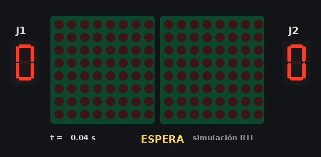
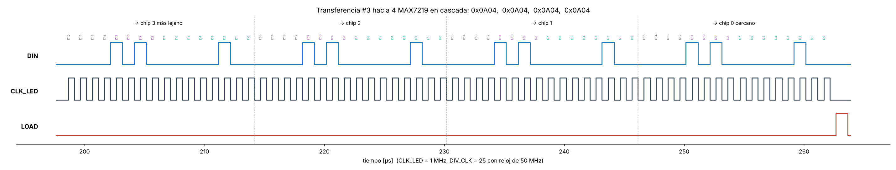

# Verificación (Fases 3 y 7 · PC2 y PC3)

Todo lo de esta página se reproduce con un solo comando desde la raíz del repositorio:

```bash
bash sim/correr_todo.sh
```

El script corre primero con **16 columnas** (dos matrices sueltas, la propuesta original) las pruebas que dependen del ancho de la cancha, y después **todo con 32 columnas** (el módulo MAX7219 x4 que vamos a usar). Los registros completos quedan en [`sim/logs/`](../sim/logs/): los de 32 columnas se llaman `tb_<nombre>.log` y los de 16, `tb_<nombre>_16.log`. Las formas de onda (`.vcd`) quedan en `sim/` para abrirlas con GTKWave.

Ningún testbench depende de "mirar la onda y ver si se ve bien": todos comparan contra un valor esperado y terminan con una línea `RESULTADO ...: PASA` o `FALLA`.

## Resumen de resultados

| Testbench | Pruebas de la guía | Verificaciones (32 col.) | (16 col.) | Resultado |
|-----------|--------------------|------------------------:|----------:|:---------:|
| `tb_colisiones` | T04, T05 | 184 320 | 92 160 | PASA |
| `tb_paletas` | T01, T02, T09 | 15 + monitor por ciclo | — | PASA |
| `tb_pelota` | T03, T04, T05 | 12 187 + monitor | 12 107 + monitor | PASA |
| `tb_puntaje` | T05, T06 | 11 | — | PASA |
| `tb_control_juego` | T05, T06, T09 | 22 | — | PASA |
| `tb_entradas` | T09 | 18 | — | PASA |
| `tb_generador_ticks` | T03 | 8 + monitor por ciclo | — | PASA |
| `tb_imagen` | T07 | 17 867 | 8 651 | PASA |
| `tb_siete_segmentos` | T06 | 48 | — | PASA |
| `tb_max7219` | T08 | 23 + chequeo de tiempos | 19 + chequeo | PASA |
| `tb_integracion` | T01-T09 de extremo a extremo | 28 + monitores por ciclo | 28 + monitores | PASA |

Los bloques marcados con "—" no dependen del ancho de la cancha. T10 (niveles eléctricos) es una revisión de hardware y se documenta en [`hardware.md`](hardware.md).

## Matriz requisito – prueba – evidencia

| Req. | Qué comprobamos | Dónde | Evidencia |
|------|-----------------|-------|-----------|
| R01 | Una orden solo mueve la paleta de su jugador, también con los dos jugando a la vez | `tb_paletas` (T01a-c), `tb_integracion` | `sim/logs/tb_paletas.log` |
| R02 | `YP ≤ 5` en **todos** los ciclos; mantener subir/bajar satura en 0 y 5 | `tb_paletas` (T02a-b + monitor) | idem |
| R03 | Sin tick la pelota no cambia; un tick = una casilla; periodos medidos | `tb_pelota`, `tb_generador_ticks` | `tb_generador_ticks.log` |
| R04 | Rebotes en techo, piso y ambas paletas; todas las combinaciones (36 864 con 32 columnas) contra un modelo independiente | `tb_colisiones`, `tb_pelota` (T04a-d) | `tb_colisiones.log` |
| R05 | Cada escape produce exactamente un pulso de gol (138 de 138 en la partida aleatoria con 32 columnas, 274 de 274 con 16) y suma un punto al rival | `tb_pelota`, `tb_puntaje`, `tb_integracion` | `tb_pelota.log` |
| R06 | Saturación en 9, `limpiar`, RESET a mitad de juego, FIN → ESPERA en 0-0 | `tb_puntaje`, `tb_control_juego`, `tb_integracion` | `tb_integracion.log` |
| R07 | Todos los LEDs correctos en todas las escenas posibles; ocultar pelota; efecto de fin; patrón de calibración | `tb_imagen` | `tb_imagen.log` |
| R08 | Configuración en los 4 chips, 64 bits por transferencia, patrones reconstruidos desde los registros de los 4 chips, ambos órdenes de cadena, cero violaciones de tiempo | `tb_max7219`, `tb_integracion` | `tb_max7219.log`, cronograma abajo |
| R09 | Rebotes filtrados, VT anula órdenes enclavadas, la caída de enlace pausa, no se reanuda sin enlace, START con rebotes da un pulso | `tb_entradas`, `tb_control_juego`, `tb_integracion` | `tb_entradas.log` |
| R10 | — | revisión de hardware | [`hardware.md`](hardware.md) |

## La partida completa (`tb_integracion`)

La prueba de integración conecta `pong_top` completo a una cadena de cuatro modelos de MAX7219 escritos a partir de la hoja de datos (como el módulo x4) y a dos jugadores robot. Para que corriera rápido le dijimos al diseño que el reloj es de 20 kHz, pero como todo está expresado en milisegundos, **la partida simulada dura lo mismo que en la vida real**.

| Medida | 8 × 32 (módulo x4) | 8 × 16 |
|--------|-------------------:|-------:|
| Marcador final | J1 9 - 6 J2 | J1 5 - 9 J2 |
| Goles registrados (todos con exactamente un punto) | 16 | 14 |
| Rebotes en paleta | 52 | 42 |
| Nivel de velocidad máximo alcanzado | 3 | 3 |
| Pantallas comparadas MAX7219 vs. imagen interna | 5063 (0 diferencias) | 5868 (0 diferencias) |
| Violaciones de tiempo del MAX7219 | 0 | 0 |
| Tiempo de juego simulado | 270 s | 162 s |

En las dos versiones también pasan: pausa por START, caída del enlace de J2 con su botón pegado, intento de reanudar sin enlace, FIN → ESPERA → partida nueva → RESET, y el patrón de calibración visto en los LEDs mientras se sostiene RESET.

Esta animación está hecha con lo que quedó **en los registros de los cuatro modelos de MAX7219**, o sea, lo que se vería en los LEDs; no con la imagen interna del diseño:



El registro de la partida trae además la pantalla en ASCII en el instante de cada gol, por ejemplo:

```
  t=16457 ms: gol de J2
   +--------------------------------+   J1 0 - 1 J2
   |................................|
   |O...............................|
   |O...............................|
   |O...............................|
   |................................|
   |...............................O|
   |O..............................O|
   |...............................O|
   +--------------------------------+
```

(La pelota quedó en la fila 6 de la columna 0, justo debajo de la paleta de J1.)

## Cronograma serial (DIN / CLK_LED / LOAD)

Tomado directamente del VCD de `tb_max7219` con `scripts/cronograma_max7219.py`. Es la palabra de brillo `0x0A04` enviada a los cuatro chips del módulo x4:



* Una pantalla completa tarda **528 µs** con 4 chips (~1890 refrescos por segundo); con 2 chips, 272 µs.
* DIN tiene 500 ns de setup antes de cada flanco de subida (la hoja pide 25 ns).
* LOAD sube 500 ns después del último flanco de CLK y dura 1 µs (la hoja pide 50 ns).

## Lo que la simulación nos encontró

Vale la pena dejarlo escrito, porque es justo la razón por la que la guía nos pedía simular antes de comprar: estos errores **compilaban sin problema** y habrían llegado al montaje.

1. **El brillo nunca llegaba** a los MAX7219 (dirección mal armada). Lo descubrió el modelo del chip en `tb_max7219`. En el camino nos dimos cuenta de que nuestro chequeo dejaba pasar valores en X, y lo corregimos.
2. **Violación de setup en DIN** cuando el divisor del reloj serial vale 1. Con el divisor real no se notaba, pero era un error de diseño de la FSM. Lo vio el modelo del chip en la prueba de integración.
3. **Periodo de la pelota en X** al inicio de la simulación por un `always @(*)` que no se evaluaba en t = 0.

También hubo dos errores en los propios testbenches (H-04 y H-05). El detalle está en la tabla de hallazgos de [`decisiones.md`](decisiones.md).

## Síntesis de prueba

Antes de tener Quartus a la mano revisamos con Yosys que todo el RTL sea sintetizable y no infiera latches:

```bash
bash scripts/sintesis_yosys.sh
```

| Recurso (Yosys, `synth_intel -family cycloneive`, 32 columnas) | Cantidad | EP4CE10E22C8N |
|----------------------------------------------------------------|---------:|--------------:|
| Celdas lógicas (`lcell_comb`) | ~2000 | 10 320 LE |
| Flip-flops (`dffeas`) | 631 | 10 320 |
| Latches inferidos | 0 | — |

Es una estimación (alrededor del 20 % de la FPGA): Quartus II optimiza distinto y el número final lo tomamos de su reporte en PC4.
