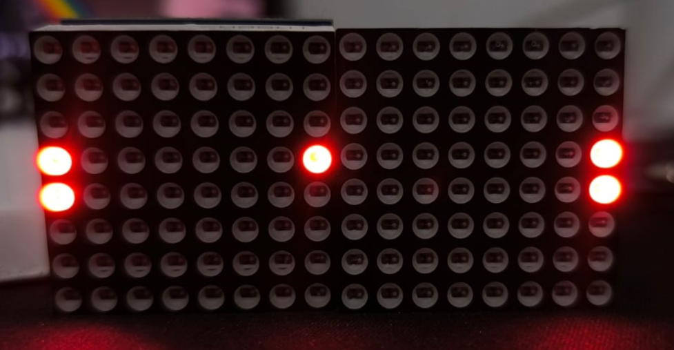

# F4 · Interfaz visual con las dos matrices MAX7219

7 de noviembre de 2026 · **PC4**

*Las dos matrices mostrando el estado inicial: paletas de 2 LED en las columnas 0 y 15, pelota en (7, 3).*

Fue la primera vez que probamos el diseño en la tarjeta. Usamos el top [`pong_f4_visual_top.v`](../../fpga/rtl/pong_f4_visual_top.v) (con botones y controles fijos en reposo):

* Compilación completa en Quartus: sin errores ([`quartus_reportes/`](quartus_reportes/)): 160 elementos lógicos y *slack* de setup de +11,1 ns.
* La programación por USB-Blaster/JTAG salió bien.
* En la alimentación de las matrices medimos 5,23 V. Adaptador 74HCT245 y fuente de 5 V / 3 A.
* Cascada de los dos controladores funcionando; imagen estable durante 30 s.
* Pines: `CLK_SYS` = 23, `DIN` = 28, `CLK_LED` = 31, `LOAD` = 33.

**Lo que tuvimos que corregir:** la imagen se veía en espejo y de cabeza.

* Horizontal (`imagen.v`): la columna 0 de cada matriz pasó al bit 0 del byte.
* Vertical (`transmisor_max7219.v`): la fila 0 pasó al registro 8 (`ROW_ADDR = 8 − ROW_IDX`).

Por esas correcciones, tres testbenches de F3 (`tb_imagen`, `tb_transmisor_max7219` y `tb_pong_max7219_integrado`) esperaban la orientación vieja. Les actualizamos los valores esperados; están marcados con el comentario *Ajuste F4*.

De F4 nos quedó pendiente habilitar el 74HCT245 de forma segura al encender y apagar. Lo resolvimos en F6 con `HCT_EN` y los 2N3904.

El detalle completo está en [`F4_RESULTADOS_VALIDACION.txt`](F4_RESULTADOS_VALIDACION.txt).
