# F8 · Placa principal en KiCad

Noviembre de 2026

Pasamos a KiCad el circuito que ya teníamos validado en protoboard en F6. Como el profesor aprobó dejar los mandos y los pulsadores en protoboard, hicimos una sola placa: la principal, con las matrices, los búferes y el marcador.

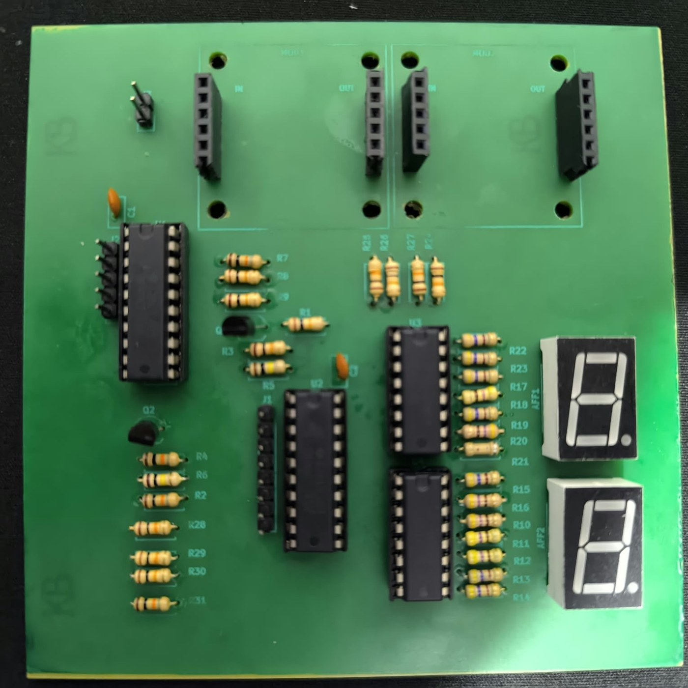

## Qué lleva la placa

| Referencia | Componente | Función |
|------------|------------|---------|
| U1 | SN74HCT245N | Búfer de 3,3 V a 5 V para DIN, CLK y CS de las matrices |
| U2 | SN74HCT245N | Búfer de 3,3 V a 5 V para los ocho bits BCD |
| Q1, Q2 | 2N3904 | Habilitan el /OE de U1 y U2 cuando sube `HCT_EN` |
| R1, R2 | 10 kΩ | Pull-up del /OE de cada búfer a 5 V |
| R3, R4 | 10 kΩ | Resistencia de base de Q1 y Q2 |
| R5, R6 | 100 kΩ | Pull-down de base de Q1 y Q2 |
| R7, R8, R9 | 10 kΩ | DIN y CLK a GND, CS a 5 V |
| R24–R31 | 10 kΩ | Pull-down de las ocho entradas BCD (marcador en 0–0 sin señal) |
| U3, U4 | CD4511BE | Decodificador BCD a 7 segmentos de J1 y J2 |
| R10–R23 | 470 Ω | Una por segmento (7 por display) |
| AFF1, AFF2 | 5161AS | Displays de cátodo común |
| C1, C2 | 100 nF | Desacople de U1 y U2 |
| MOD1, MOD2 | Espadines hembra 1×5 | Conectores IN y OUT de las dos matrices FC-16 (se insertan con los LED hacia arriba) |
| J1 | 8 pines | Bits BCD desde el conector LCD de la tarjeta (pines 101, 103–106 y 110–112) |
| J2 | 5 pines | DIN (28), CLK_LED (31), LOAD (33), HCT_EN (49) y GND |
| J3 | 2 pines | +5 V y GND de la fuente externa |

Las conexiones son las mismas de F6: mismos pines de la FPGA, mismos valores y la misma asignación de segmentos. El detalle pin a pin está en [`hardware/`](../../hardware/).

## Esquema y diseño

| Esquema de la placa | Trazado en KiCad |
|---------------------|------------------|
| 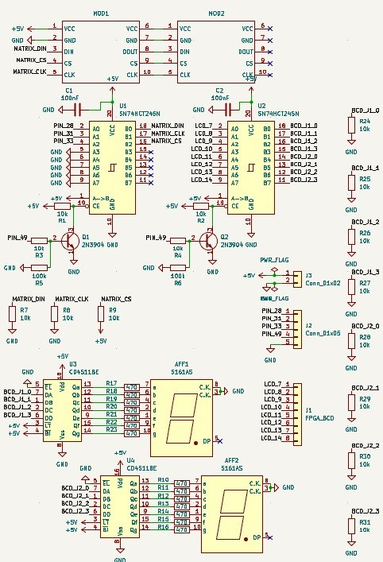 | 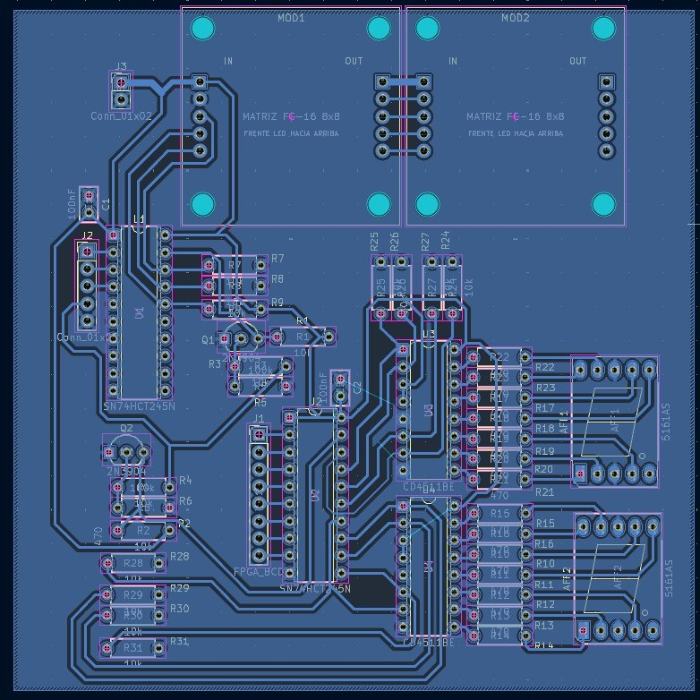 |

| Vista 3D, componentes | Vista 3D, soldadura |
|-----------------------|---------------------|
| 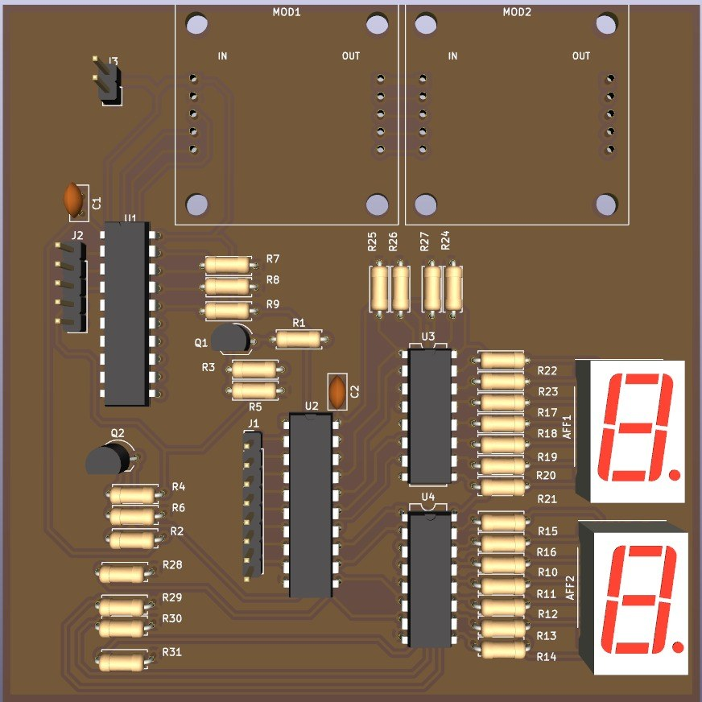 | 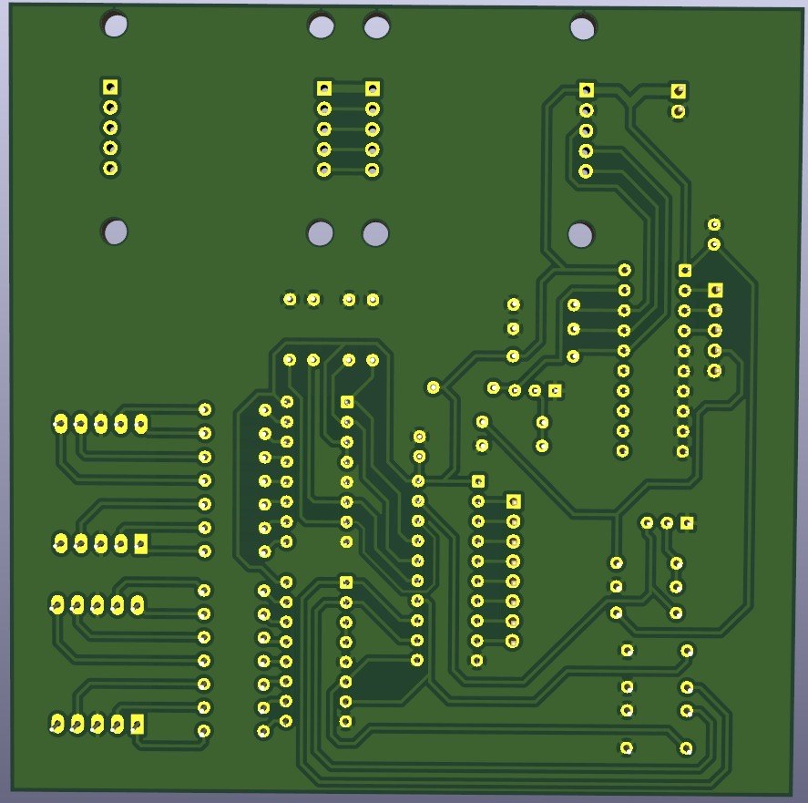 |

La placa es de una sola capa de cobre (cara de soldadura) y mide unos 9 cm de lado. Cuatro conexiones no se pudieron trazar en una sola capa sin cruzarse (las líneas finas del trazado). En la placa fabricada las hicimos con puentes de cable aislado por la cara de soldadura:

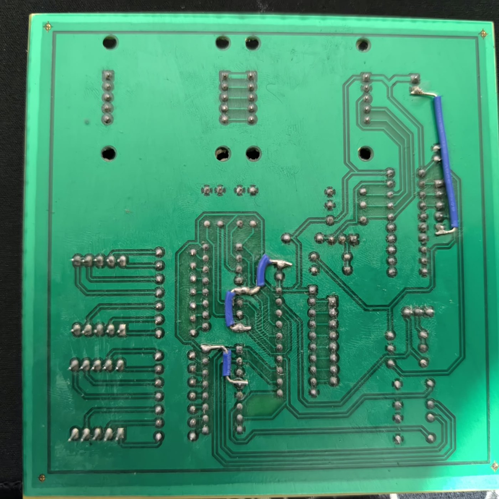

Los integrados van sobre bases, así que se pueden cambiar y probar la placa por partes.

## Controles en protoboard

Cada pulsador lleva su línea a GND y tiene pull-up de 10 kΩ a 3,3 V (tomados de la tarjeta). Las líneas DETECT (pines 34 y 42) van a la tierra de cada mando.

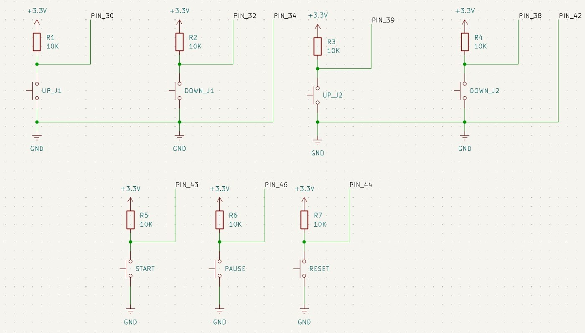

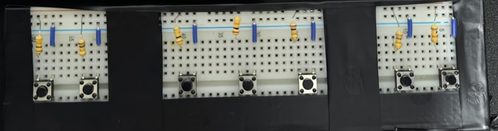

De izquierda a derecha: los dos pulsadores de J1, luego START, PAUSE y RESET, y los dos de J2.

## Montaje final

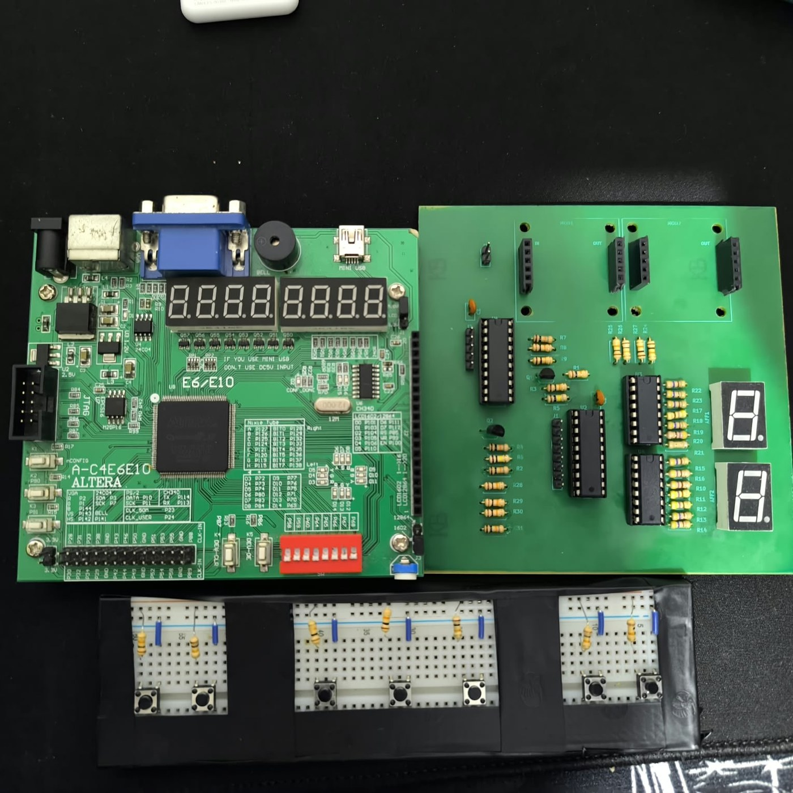

Tarjeta A-C4E6E10, placa principal (en la foto, con las matrices retiradas para que se vean los conectores) y controles en protoboard. Con las matrices insertadas, el sistema completo funciona igual que en protoboard.

## Sistema funcionando con la placa

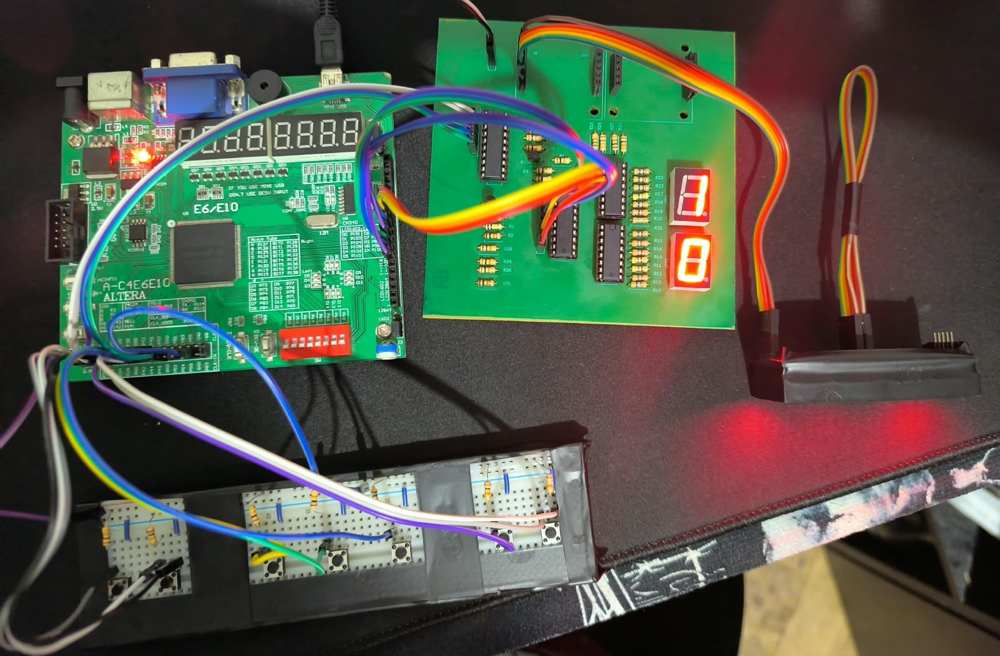

Así quedó el montaje final: la tarjeta con el diseño cargado, la placa principal con el marcador (aquí en 1–0), las dos matrices en su soporte conectadas a la placa por cable plano (a la derecha) y los controles en tres secciones de protoboard fijadas sobre una base (abajo).

| Tablero durante el juego | Marcador |
|--------------------------|----------|
| 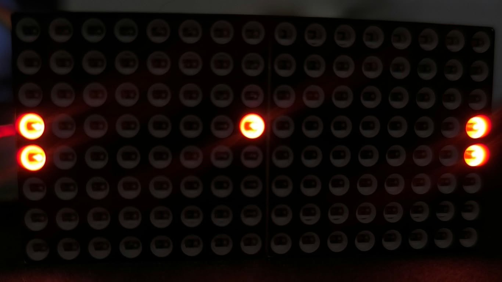 | 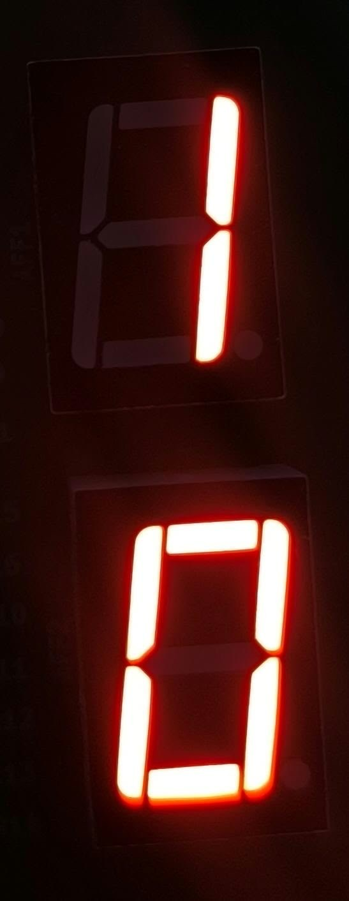 |

Paletas de J1 (columna 0) y J2 (columna 15) con la pelota en el centro para el saque, y marcador 1–0 después del primer gol (arriba J1, abajo J2).

## Video de demostración

[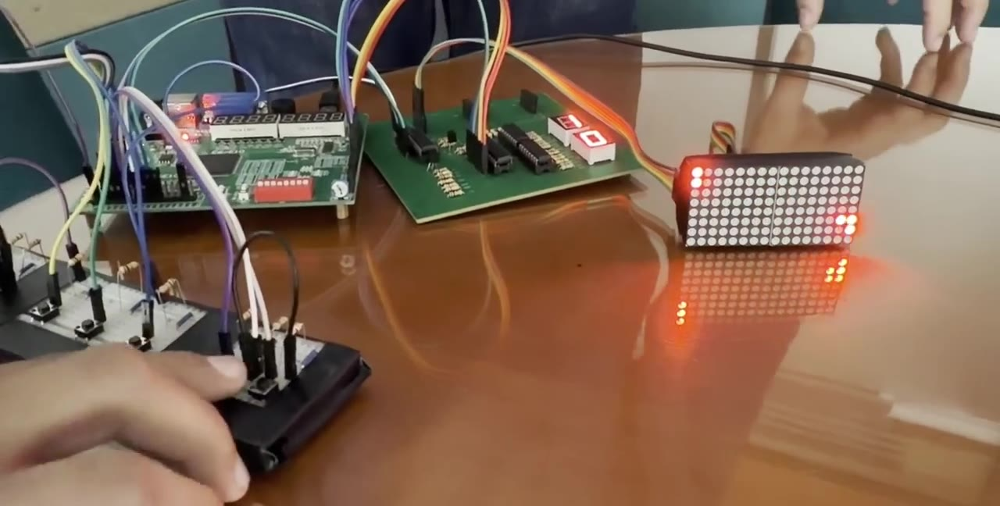](video_demostracion.mp4)

[`video_demostracion.mp4`](video_demostracion.mp4) (20 s): partida en el montaje final. Se ven las paletas moviéndose con los mandos de la protoboard, la pelota en diagonal rebotando en las paletas y en los bordes, el marcador avanzando con cada gol y, al final, un acercamiento a la placa con el marcador.

## Extensiones posibles

La placa quedó completa y funcionando. Sobre esta base, una versión de dos capas eliminaría los puentes de cable y dejaría espacio para condensadores de desacople junto a los CD4511BE y una tierra adicional por J1.
