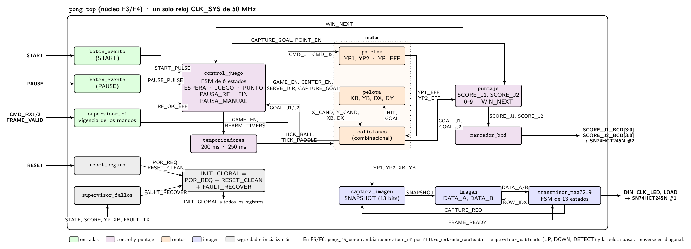

# Código Verilog y proyecto de Quartus

Esta carpeta tiene el diseño final del Pong (F6): el núcleo de F5 con los mandos cableados y la pelota diagonal, más el marcador BCD del top de F6.



La máquina de estados del juego está en [`fig_fsm`](../informes/figuras/fig_fsm.png).

**La explicación detallada de cada archivo está en [`docs/`](docs/README.md)**: qué hace cada módulo, sus puertos, cómo funciona por dentro, por qué lo hicimos así y con qué bancos de prueba lo verificamos.

## Archivos

En la tabla, el nombre de cada archivo lleva a su documentación.

| Archivo | Bloque | Qué hace |
|---------|--------|----------|
| [`rtl/pong_f6_integracion_top.v`](docs/pong_f6_integracion_top.md) | **Top final** | Entradas activas en bajo, salidas a las matrices y al marcador BCD, `HCT_EN` 50 ms después de arrancar |
| [`rtl/pong_f5_core.v`](docs/pong_f5_core.md) | Integración | Núcleo del juego: conecta todos los bloques |
| [`rtl/pong_f5_controles_top.v`](docs/pong_f5_controles_top.md) | Top de F5 | Igual al final pero sin las salidas del marcador |
| [`rtl/filtro_entrada_cableada.v`](docs/filtro_entrada_cableada.md) | Entradas | Sincroniza y filtra (20 ms) UP, DOWN y DETECT |
| [`rtl/supervisor_cableado.v`](docs/supervisor_cableado.md) | Entradas | Comandos de cada mando y vigencia (`RF_OK_EFF`) a partir de DETECT |
| [`rtl/boton_evento.v`](docs/boton_evento.md) | Entradas | Sincroniza, filtra y da un pulso por pulsación (START, PAUSE) |
| [`rtl/reset_seguro.v`](docs/reset_seguro.md) | Seguridad | Reset de arranque (`POR_REQ`) y RESET físico con liberación filtrada |
| [`rtl/control_juego.v`](docs/control_juego.md) | Control | FSM de seis estados y pulsos de captura de gol, punto, centrado y rearme |
| [`rtl/temporizadores.v`](docs/temporizadores.md) | Temporización | Pulsos de pelota (200 ms) y paletas (250 ms) |
| [`rtl/paletas.v`](docs/paletas.md) | Motor | Posición de las paletas y posición efectiva para las colisiones |
| [`rtl/pelota.v`](docs/pelota.md) | Motor | Posición y dirección de la pelota; movimiento diagonal desde F5 |
| [`rtl/colisiones.v`](docs/colisiones.md) | Motor | Impactos y goles de cada jugador |
| [`rtl/puntaje.v`](docs/puntaje.md) | Marcador | Contadores 0–9, anotador y predicción de victoria |
| [`rtl/marcador_bcd.v`](docs/marcador_bcd.md) | Marcador | Buses BCD hacia los CD4511BE |
| [`rtl/captura_imagen.v`](docs/captura_imagen.md) | Video | Instantánea de 13 bits de las posiciones |
| [`rtl/imagen.v`](docs/imagen.md) | Video | Byte de cada matriz para cada fila |
| [`rtl/transmisor_max7219.v`](docs/transmisor_max7219.md) | Video | Inicialización y envío serial a los dos controladores en cascada |
| [`rtl/supervisor_fallos.v`](docs/supervisor_fallos.md) | Seguridad | Detecta estados y registros inválidos y fuerza la reinicialización |
| [`rtl/pong_top.v`](docs/pong_top.md), [`rtl/supervisor_rf.v`](docs/supervisor_rf.md) | F3 | Núcleo original con la interfaz RF; los dejamos como referencia |
| [`rtl/pong_f4_visual_top.v`](docs/pong_f4_visual_top.md) | F4 | Top de la prueba visual de las matrices |
| [`tb/tb_*.v`](docs/bancos_de_prueba.md) | Pruebas | 35 testbenches: 17 de F3 (tres con el ajuste de orientación de F4) y 18 de F5 |
| [`tb/anteriores_al_movimiento_diagonal/`](docs/bancos_de_prueba.md#bancos-archivados-tbanteriores_al_movimiento_diagonal) | Pruebas | 4 testbenches que esperan el movimiento de la pelota anterior a F5; no se corren |
| [`pong_f3.qpf`, `pong_top.qsf`, `pong_f3.sdc`](docs/proyecto_quartus.md) | Quartus | Proyecto (revisión `pong_top`, top `pong_f6_integracion_top`), pines y restricciones |

## Correr las pruebas

Las simulaciones originales las hicimos en Questa. Para repetirlas sin instalar nada pesado usamos Icarus Verilog:

```bash
sudo apt install iverilog        # en Ubuntu o WSL
bash fpga/sim/correr_pruebas.sh
```

Así nos da con el RTL final (GitHub también lo corre cada vez que subimos algo, pestaña *Actions*):

```
=========================== RESUMEN ===========================
  PASA       tb_boton_evento   OK: INIT cancela pulsacion pendiente
  PASA       tb_captura_imagen   PRUEBAS SUPERADAS: 13
  PASA       tb_colisiones   PRUEBAS SUPERADAS: 87823
  PASA       tb_colisiones_puntaje_f5   COLISIONES Y PUNTAJE F5: 12/12 PASS
  PASA       tb_control_juego   COMBINACIONES FSM OK: 512
  PASA       tb_gc7219_temporizacion_f5   PASS: 88/88 tramas comprobadas (4 x 22)
  PASA       tb_hct_arranque_f5   PASS: arranque y habilitacion HCT correctos
  PASA       tb_hct_controles_cableados_f5   PASS: todas las tramas verificadas con 32 bits
  PASA       tb_hct_filas_f5   PASS: 22/22 tramas de 32 bits correctas
  PASA       tb_hct_init_max7219_f5   PASS: INIT_MODE desactivado correctamente
  PASA       tb_hct_refresco_f5   PASS: 38/38 tramas de 32 bits correctas
  PASA       tb_hct_reset_pausa_f5   PASS: PAUSE, reanudacion y RESET correctos
  PASA       tb_imagen   TOTAL VERIFICADO: 65546
  PASA       tb_inicio_reset_integrado_f5   INICIO Y RESET F5: 11/11 PASS
  PASA       tb_integracion_temporizada_f5   INTEGRACION TEMPORIZADA F5: 10/10 PASS
  PASA       tb_marcador_bcd   TOTAL DE COMPROBACIONES: 356
  PASA       tb_paletas   PRUEBAS SUPERADAS: 14
  PASA       tb_paletas_cableadas_f5   PALETAS F5: 14/14 PASS
  PASA       tb_pausas_cableadas_f5   PAUSAS F5: 18/18 PASS
  PASA       tb_pelota_diagonal_f5   PASS: pelota diagonal F5; 12 verificaciones correctas
  PASA       tb_pelota_goles_diagonal_f5   PASS: pelota + colisiones + goles diagonales F5; 14/14 pruebas correctas
  PASA       tb_pong_goles_victoria   COMPROBACIONES: 13 / 13
  PASA       tb_pong_integracion   COMPROBACIONES DE INTEGRACION: 9 / 9
  PASA       tb_pong_max7219_integrado   COMPROBACIONES: 8 / 8
  PASA       tb_pong_recuperacion_fallos   COMPROBACIONES: 11 / 11
  PASA       tb_puntaje   PRUEBAS SUPERADAS: 37
  PASA       tb_puntaje_reset_f5   PUNTAJE Y RESET F5: 10/10 PASS
  PASA       tb_reset_seguro   COMPROBACIONES SUPERADAS: 47
  PASA       tb_reset_seguro_f5   RESET F5: 10/10 PASS
  PASA       tb_supervisor_cableado_f5   SUPERVISOR F5: 10/10 PASS
  PASA       tb_supervisor_fallos   TOTAL VERIFICADO: 363
  PASA       tb_supervisor_rf   OK: Expiracion independiente J1
  PASA       tb_temporizadores   OK: Retencion final | CB=0 CP=0
  PASA       tb_temporizadores_f5   TEMPORIZADORES F5: 13/13 PASS
  PASA       tb_transmisor_max7219   OK: Cuadro 2 Fila 8/8 WORD=01810100
Pasan: 35   Fallan: 0
```

Los registros de cada prueba quedan en [`sim/resultados/`](sim/resultados/).

## Compilar y programar en Quartus

1. Abrir `pong_f3.qpf` con Quartus Prime (usamos la 25.1 Lite).
2. *Processing → Start Compilation*. Con el top final da 665 elementos lógicos, 379 registros, 22 pines y *slack* de +6,686 ns (setup) y +0,186 ns (hold).
3. Encender **primero** la fuente de 5 V y **después** la tarjeta.
4. *Tools → Programmer*, USB-Blaster en modo JTAG, cargar `output_files/pong_top.sof` y *Start*.

El `.qsf` ya tiene `nCEO = Use as regular I/O`, necesario para usar el pin 101 como salida BCD. La secuencia de encendido y las conexiones están en [`hardware/`](../hardware/).
