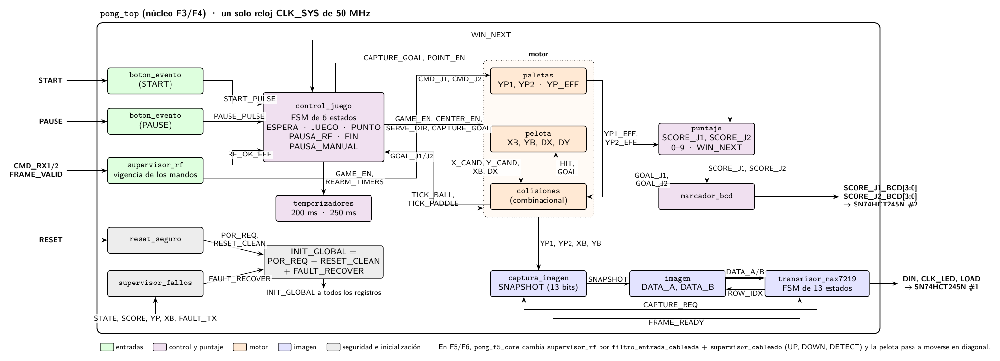

# Documentación del código

En esta carpeta explicamos, archivo por archivo, el código Verilog del Pong, el proyecto de Quartus y las pruebas. La idea es que cualquiera (el profesor, un compañero o nosotros mismos dentro de un tiempo) pueda abrir un módulo y entender qué hace, por qué lo hicimos así y cómo lo probamos, sin tener que leer el código línea por línea.

Cada documento tiene más o menos la misma estructura:

1. **Qué hace** el módulo, en pocas palabras.
2. **Dónde está** dentro del sistema: quién lo usa y a qué se conecta.
3. **Parámetros y puertos**, en tablas.
4. **Cómo funciona**, siguiendo el orden del código.
5. **Por qué lo hicimos así**: las decisiones de diseño.
6. **Cómo lo probamos**: los bancos de prueba que lo verifican.

## Mapa del diseño



El diseño que cargamos en la FPGA es `pong_f6_integracion_top`. Adentro tiene el núcleo `pong_f5_core`, que a su vez conecta todos los bloques del juego:

```
pong_f6_integracion_top          (pines de la tarjeta, HCT_EN)
└── pong_f5_core                 (une todos los bloques)
    ├── reset_seguro             arranque y RESET
    ├── boton_evento  ×2         START y PAUSE
    ├── supervisor_cableado      mandos de los jugadores
    │   └── filtro_entrada_cableada ×6
    ├── control_juego            máquina de estados
    ├── temporizadores           ritmo de pelota y paletas
    ├── paletas
    ├── pelota
    ├── colisiones
    ├── puntaje
    ├── marcador_bcd             salida al marcador de 7 segmentos
    ├── captura_imagen           "foto" de las posiciones
    ├── imagen                   qué LED se prenden en cada fila
    ├── transmisor_max7219       envío serial a las matrices
    └── supervisor_fallos        detección de estados imposibles
```

## Índice

### Diseño final (lo que corre en la tarjeta)

| Documento | Archivo | Bloque |
|-----------|---------|--------|
| [pong_f6_integracion_top](pong_f6_integracion_top.md) | `rtl/pong_f6_integracion_top.v` | Top final |
| [pong_f5_core](pong_f5_core.md) | `rtl/pong_f5_core.v` | Núcleo que conecta todo |
| [reset_seguro](reset_seguro.md) | `rtl/reset_seguro.v` | Arranque y RESET |
| [boton_evento](boton_evento.md) | `rtl/boton_evento.v` | START y PAUSE |
| [filtro_entrada_cableada](filtro_entrada_cableada.md) | `rtl/filtro_entrada_cableada.v` | Antirrebote de cada línea de los mandos |
| [supervisor_cableado](supervisor_cableado.md) | `rtl/supervisor_cableado.v` | Comandos y detección de los mandos |
| [control_juego](control_juego.md) | `rtl/control_juego.v` | Máquina de estados del juego |
| [temporizadores](temporizadores.md) | `rtl/temporizadores.v` | Pulsos de 200 ms y 250 ms |
| [paletas](paletas.md) | `rtl/paletas.v` | Movimiento de las paletas |
| [pelota](pelota.md) | `rtl/pelota.v` | Movimiento diagonal de la pelota |
| [colisiones](colisiones.md) | `rtl/colisiones.v` | Rebotes en las paletas y goles |
| [puntaje](puntaje.md) | `rtl/puntaje.v` | Contadores 0–9 y victoria |
| [marcador_bcd](marcador_bcd.md) | `rtl/marcador_bcd.v` | Salida BCD a los CD4511BE |
| [captura_imagen](captura_imagen.md) | `rtl/captura_imagen.v` | Instantánea de 13 bits |
| [imagen](imagen.md) | `rtl/imagen.v` | Bytes de cada fila para las matrices |
| [transmisor_max7219](transmisor_max7219.md) | `rtl/transmisor_max7219.v` | Comunicación serial con las matrices |
| [supervisor_fallos](supervisor_fallos.md) | `rtl/supervisor_fallos.v` | Recuperación ante valores inválidos |

### Versiones de fases anteriores (las dejamos como referencia)

| Documento | Archivo | Fase |
|-----------|---------|------|
| [pong_top](pong_top.md) | `rtl/pong_top.v` | F3: núcleo con la interfaz inalámbrica |
| [supervisor_rf](supervisor_rf.md) | `rtl/supervisor_rf.v` | F3: supervisión de los enlaces RF |
| [pong_f4_visual_top](pong_f4_visual_top.md) | `rtl/pong_f4_visual_top.v` | F4: prueba de las matrices |
| [pong_f5_controles_top](pong_f5_controles_top.md) | `rtl/pong_f5_controles_top.v` | F5: juego con mandos, sin marcador |

### Proyecto, pruebas y automatización

| Documento | Archivos |
|-----------|----------|
| [Proyecto de Quartus](proyecto_quartus.md) | `pong_f3.qpf`, `pong_top.qsf`, `pong_f3.sdc` |
| [Bancos de prueba](bancos_de_prueba.md) | `tb/tb_*.v` y `tb/anteriores_al_movimiento_diagonal/` |
| [Script de simulación y GitHub Actions](simulacion_automatica.md) | `sim/correr_pruebas.sh` y `.github/workflows/simulacion.yml` |

## Cómo se recorre una partida por el código

Para entender cómo encajan las piezas, seguimos una partida de principio a fin:

1. **Encendido.** Al programar la tarjeta, [`pong_f6_integracion_top`](pong_f6_integracion_top.md) espera 50 ms antes de subir `HCT_EN` y habilitar los búferes. Mientras tanto mantiene todo en reset. [`reset_seguro`](reset_seguro.md) suelta el reset 20 ms después, y todos los registros quedan en su valor inicial: paletas en la fila 3, pelota en (7, 3), marcador 0–0.
2. **Inicialización de las matrices.** [`transmisor_max7219`](transmisor_max7219.md) manda los 14 comandos de configuración a los dos controladores y luego empieza a refrescar la imagen sin parar.
3. **Mandos conectados.** [`supervisor_cableado`](supervisor_cableado.md) ve las dos líneas DETECT en 0 y avisa que los dos mandos están listos (`RF_OK_EFF = 1`).
4. **START.** [`boton_evento`](boton_evento.md) convierte la pulsación en un pulso de un ciclo. [`control_juego`](control_juego.md) pasa de ESPERA a JUEGO y rearma los temporizadores.
5. **Juego.** [`temporizadores`](temporizadores.md) da un pulso a la pelota cada 200 ms y a las paletas cada 250 ms. En cada pulso, [`paletas`](paletas.md) mueve según el mando, [`pelota`](pelota.md) calcula su siguiente casilla y [`colisiones`](colisiones.md) decide si hay rebote, gol o nada.
6. **Gol.** La máquina de estados pasa por PUNTO durante un ciclo: [`puntaje`](puntaje.md) suma el punto, las paletas y la pelota vuelven al centro y el juego queda en ESPERA hasta el siguiente START. [`marcador_bcd`](marcador_bcd.md) saca el nuevo puntaje a los displays.
7. **Imagen.** Todo el tiempo, [`captura_imagen`](captura_imagen.md) toma una foto de las posiciones al empezar cada cuadro, [`imagen`](imagen.md) la convierte en bytes fila por fila y el transmisor los envía.
8. **Victoria.** Cuando un jugador llega a 9, la máquina de estados entra en FIN y se queda ahí hasta que alguien presiona RESET.
9. **Imprevistos.** Si se desconecta un mando, el juego pasa a PAUSA_RF. Si algún registro toma un valor imposible, [`supervisor_fallos`](supervisor_fallos.md) reinicia todo el sistema.

## Convenciones que usamos en el código

* **Nombres de señales en mayúsculas**, como en los documentos de F1 y F2, para poder buscar una señal en el código y en las ecuaciones con el mismo nombre.
* **Sufijo `_N`**: la señal es activa en bajo. Por ejemplo, `J1_UP_N = 0` significa que el jugador 1 está presionando subir.
* **`INIT_GLOBAL`** es el reset de todo el sistema. Tiene prioridad sobre cualquier otra cosa en todos los módulos.
* **Todo es síncrono** con el reloj de 50 MHz (`CLK_SYS`). Los módulos no generan relojes propios: usan pulsos de habilitación de un ciclo (`TICK_BALL`, `TICK_PADDLE`, `START_PULSE`...).
* **Parámetros de tiempo** (`NDB`, `N_BALL`, `N_PADDLE`, `H`...): tienen el valor real para 50 MHz, y en los bancos de prueba los reducimos para que la simulación no tarde horas.
* **Nombres "RF"**: varias señales todavía se llaman `RF_OK_EFF`, `PAUSA_RF`, etc., porque al principio los mandos iban a ser inalámbricos. Cuando pasamos a mandos cableados en F5 mantuvimos los nombres para no tocar la máquina de estados, que ya estaba probada. Hoy significan "los dos mandos están conectados".
