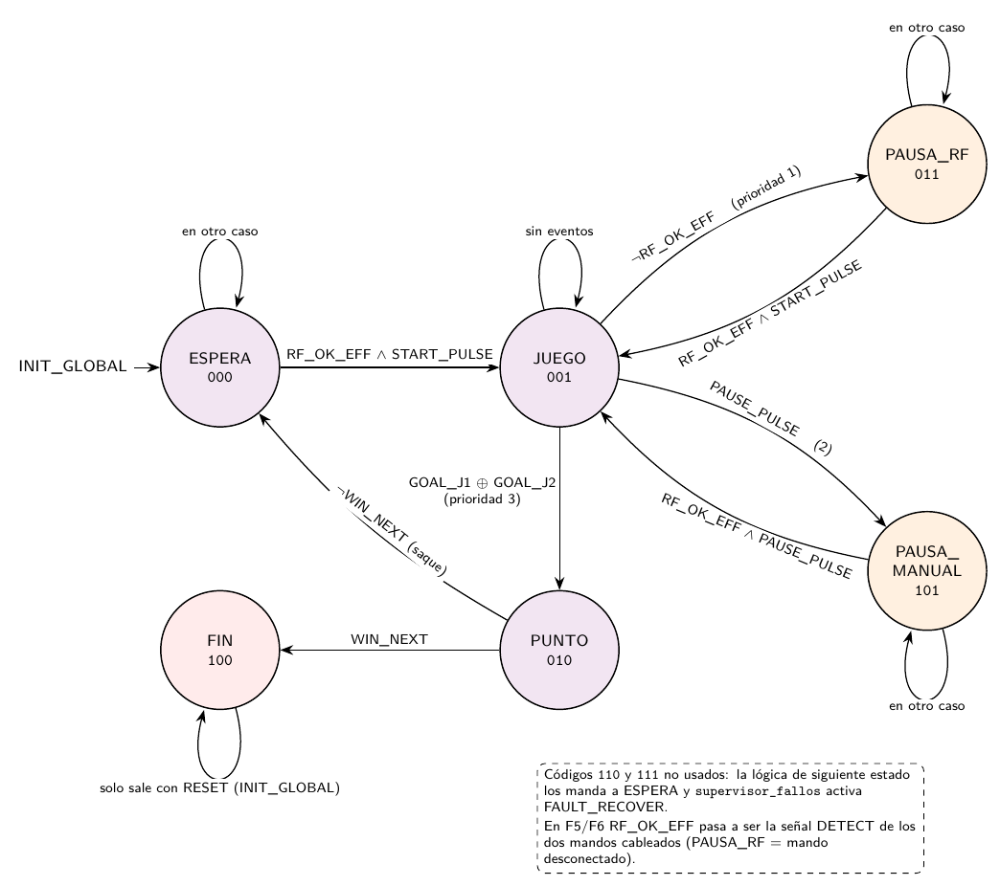

# `control_juego.v`: máquina de estados del juego

[Volver al índice](README.md) · Código: [`rtl/control_juego.v`](../rtl/control_juego.v)

## Qué hace

Es el "cerebro" del Pong. Decide en qué situación está el juego (esperando, jugando, en pausa, etc.) y, según eso, da permiso a los demás bloques para moverse, sumar puntos o volver al centro. La implementamos como una máquina de estados finitos (FSM) de seis estados. Algunas salidas dependen solo del estado y otras también de las entradas del mismo ciclo, para poder reaccionar sin esperar al siguiente flanco.



## Puertos

| Puerto | Dirección | Descripción |
|--------|-----------|-------------|
| `CLK_SYS`, `INIT_GLOBAL` | entrada | Reloj y reset |
| `START_PULSE`, `PAUSE_PULSE` | entrada | Pulsos de un ciclo de [`boton_evento`](boton_evento.md) |
| `RF_OK_EFF` | entrada | 1 = los dos mandos están conectados |
| `GOAL_J1`, `GOAL_J2` | entrada | Gol de cada jugador, desde [`colisiones`](colisiones.md) |
| `WIN_NEXT` | entrada | El punto que se va a sumar es el noveno, desde [`puntaje`](puntaje.md) |
| `STATE[2:0]` | salida | Estado actual |
| `GAME_EN` | salida | Permiso para que el juego avance |
| `CAPTURE_GOAL` | salida | Se está registrando un gol en este ciclo |
| `POINT_EN` | salida | Sumar el punto en este ciclo |
| `CENTER_EN` | salida | Llevar pelota y paletas al centro |
| `REARM_TIMERS` | salida | Poner los temporizadores en cero |
| `SERVE_DIR` | salida | Hacia dónde sale la pelota en el próximo saque (1 = derecha) |

## Estados

| Código | Estado | Qué pasa |
|--------|--------|----------|
| `000` | ESPERA | Todo quieto. Se espera START con los dos mandos conectados |
| `001` | JUEGO | La pelota y las paletas se mueven |
| `010` | PUNTO | Dura un ciclo: se suma el punto y se decide si alguien ganó |
| `011` | PAUSA_RF | Se desconectó un mando. Se sale con START cuando vuelvan a estar los dos |
| `100` | FIN | Alguien llegó a 9. Solo se sale con RESET |
| `101` | PAUSA_MANUAL | Alguien presionó PAUSE. Se sale con otro PAUSE |

Los códigos `110` y `111` no se usan. Si por algún motivo el registro llegara a tomarlos, la FSM vuelve a ESPERA (rama `default`) y además [`supervisor_fallos`](supervisor_fallos.md) reinicia todo el sistema.

## Transiciones

```
ESPERA        --START (mandos OK)-->          JUEGO
JUEGO         --mando desconectado-->         PAUSA_RF       (prioridad 1)
JUEGO         --PAUSE-->                      PAUSA_MANUAL   (prioridad 2)
JUEGO         --gol-->                        PUNTO          (prioridad 3)
PUNTO         --era el noveno punto-->        FIN
PUNTO         --si no-->                      ESPERA
PAUSA_RF      --START (mandos OK)-->          JUEGO
PAUSA_MANUAL  --PAUSE (mandos OK)-->          JUEGO
FIN           --(solo RESET)-->               ESPERA
```

Desde JUEGO hay tres salidas posibles y pueden coincidir en el mismo ciclo, así que les pusimos prioridad: primero la desconexión, después la pausa y por último el gol.

Un gol solo cuenta si es de **un solo** jugador:

```verilog
assign GOAL_VALID = GOAL_J1 ^ GOAL_J2;
```

Con la geometría del tablero no pueden ocurrir los dos goles a la vez, pero la XOR nos protege si por un fallo llegaran las dos señales juntas.

## Salidas de control

```verilog
assign GAME_EN      = (STATE == JUEGO) && RF_OK_EFF && !PAUSE_PULSE && !INIT_GLOBAL;
assign CAPTURE_GOAL = GAME_EN && GOAL_VALID;
assign POINT_EN     = (STATE == PUNTO) && !INIT_GLOBAL;
assign CENTER_EN    = (STATE == PUNTO) && !WIN_NEXT && !INIT_GLOBAL;
```

* **`GAME_EN`** no depende solo del estado. Si en el mismo ciclo llega PAUSE o se desconecta un mando, el juego se frena **en ese mismo ciclo**, sin esperar al cambio de estado del siguiente flanco. Así ni la pelota ni las paletas alcanzan a dar un paso extra.
* **`CAPTURE_GOAL`** marca el ciclo exacto del gol. Lo usan [`puntaje`](puntaje.md), para recordar quién anotó, y [`paletas`](paletas.md), para congelarse.
* **`POINT_EN`** suma el punto durante el único ciclo de PUNTO.
* **`CENTER_EN`** devuelve la pelota y las paletas al centro, pero **no** si ese punto fue el de la victoria. En ese caso el tablero se queda congelado mostrando la jugada final.

### Rearme de los temporizadores

```verilog
assign REARM_TIMERS = !INIT_GLOBAL && RF_OK_EFF && (
      (START_PULSE && (STATE == ESPERA || STATE == PAUSA_RF))
   || (PAUSE_PULSE && STATE == PAUSA_MANUAL));
```

Se activa exactamente en los ciclos en que el juego va a pasar a JUEGO. Pone en cero los contadores de [`temporizadores`](temporizadores.md), para que el primer movimiento después de un saque o de una pausa ocurra 200 ms después, siempre igual, y no en un momento que dependa de cuándo se detuvo el contador.

### Alternancia del saque

```verilog
if (INIT_GLOBAL)       SERVE_DIR <= 1'b1;
else if (CAPTURE_GOAL) SERVE_DIR <= ~SERVE_DIR;
```

El primer saque va hacia la derecha (hacia el jugador 2) y en cada gol se invierte la dirección. Así los saques se alternan entre los dos lados.

## Por qué lo hicimos así

* **Seis estados y no más.** Salen directamente de las reglas de F0: esperar, jugar, anotar, terminar y dos tipos de pausa. Separar las pausas permite que cada una tenga su propia forma de salir: la pausa manual se quita con el mismo botón PAUSE, y la de desconexión con START, para que el juego no se reanude solo apenas se reconecte el cable.
* **PUNTO de un ciclo.** Sumar el punto y decidir la victoria en un estado propio evita que el marcador y la decisión de FIN se mezclen con la lógica de JUEGO.
* **Lógica de próximo estado y registro separados.** Un `always @(*)` calcula `NEXT_STATE` y otro `always @(posedge CLK_SYS)` lo guarda. Es la misma separación que hicimos en las tablas de F2, así que es fácil comparar el código con las ecuaciones.

## Cómo lo probamos

* `tb_control_juego` (F3): prueba exhaustiva de las 512 combinaciones de estado y entradas contra un modelo de referencia, más pruebas dirigidas de cada transición.
* `tb_pausas_cableadas_f5`: 18 pruebas de las dos pausas con los mandos reales.
* `tb_colisiones_puntaje_f5` y `tb_pelota_goles_diagonal_f5`: el ciclo gol → PUNTO → ESPERA → nuevo saque.
* `tb_pong_integracion`: arranque, pausas y pérdida del enlace en el sistema completo.
* `tb_pong_goles_victoria`: diez goles hasta FIN con 9–1, FIN que ignora START y RESET que vuelve a 0–0.

## Historia

Escrito en F3 a partir de la FSM de F2 (rev. 1.2, que agregó la pausa manual). No cambió en las fases siguientes: el paso a mandos cableados en F5 se resolvió sin tocarla.
