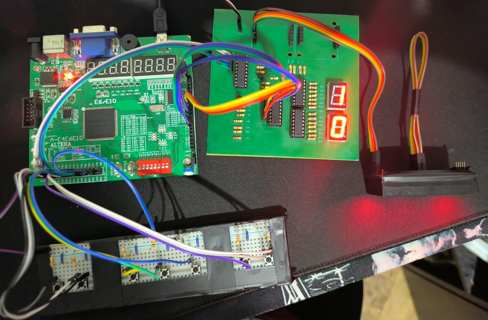
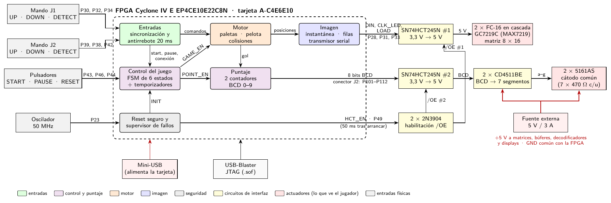
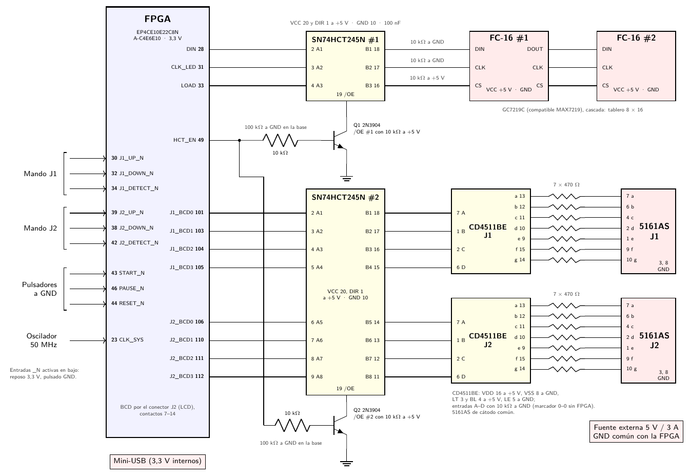
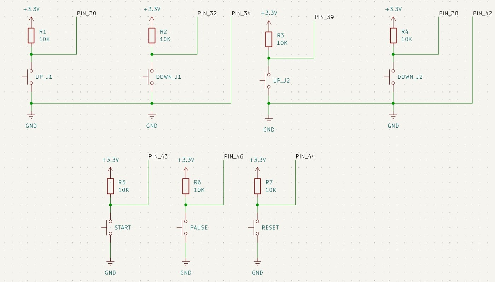

# Hardware del prototipo

Todo lo de esta página lo sacamos de nuestras memorias de F4 a F8 ([`fases/`](../fases/)). Las conexiones son las que validamos en protoboard en F6; en F8 pasamos las matrices, los búferes y el marcador a una placa impresa hecha en KiCad, y los controles quedaron en protoboard con aprobación del profesor. Las fotos, el esquema y el trazado de la placa están en [`fases/F8_pcb_kicad/`](../fases/F8_pcb_kicad/).

## Lista de componentes

| Componente | Cant. | Función |
|------------|:-----:|---------|
| Tarjeta A-C4E6E10 con FPGA Cyclone IV E EP4CE10E22C8N | 1 | Lógica del juego, reloj de 50 MHz y GPIO (la prestó la universidad) |
| Módulo FC-16 de matriz LED 8 × 8 (controlador GC7219C, compatible con MAX7219) | 2 | Tablero de 8 × 16 LED, en cascada |
| SN74HCT245N | 2 | Adaptación de niveles 3,3 V → 5 V: #1 para las matrices, #2 para el marcador |
| CD4511BE | 2 | Decodificador BCD a 7 segmentos, uno por jugador |
| Display 5161AS de cátodo común | 2 | Un dígito de puntaje por jugador |
| 2N3904 | 2 | Habilitan la salida (/OE) de cada SN74HCT245N |
| Resistencia de 470 Ω | 14 | Una por segmento a–g (7 por display) |
| Resistencia de 10 kΩ | 22 | En la placa: 8 pull-down en las entradas BCD, 2 pull-up en /OE, 2 de base y 3 en las líneas seriales. En los controles: 7 pull-up a 3,3 V |
| Resistencia de 100 kΩ | 2 | Pull-down de base de cada 2N3904 |
| Condensador de 100 nF | 2 | Desacoplo de cada SN74HCT245N |
| Pulsadores de los mandos (UP, DOWN) | 4 | Controles de J1 y J2, en protoboard |
| Pulsadores | 3 | START, PAUSE y RESET, en protoboard |
| Placa principal (F8) | 1 | Búferes, marcador y conectores de las matrices |
| Fuente externa de 5 V / 3 A | 1 | Matrices, búferes, decodificadores y displays |
| Protoboards y cables | — | Controles y conexiones a la tarjeta |

## Conexiones

Las entradas con sufijo `_N` son activas en bajo: el pulsador lleva la línea a GND y una resistencia de 10 kΩ la sube a 3,3 V en reposo (los 3,3 V salen de la tarjeta, nunca de la fuente de 5 V). Las líneas DETECT de cada mando van a su tierra: mientras el mando está conectado la FPGA lee 0, y si se suelta ese cable el juego pasa a PAUSA_RF.

### Reloj y entradas

| Función | Puerto RTL | Pin FPGA | Conexión |
|---------|-----------|:--------:|----------|
| Reloj 50 MHz | `CLK_SYS` | 23 | Oscilador de la tarjeta |
| J1 arriba | `J1_UP_N` | 30 | Mando J1 |
| J1 abajo | `J1_DOWN_N` | 32 | Mando J1 |
| J1 conectado | `J1_DETECT_N` | 34 | Mando J1 |
| J2 arriba | `J2_UP_N` | 39 | Mando J2 |
| J2 abajo | `J2_DOWN_N` | 38 | Mando J2 |
| J2 conectado | `J2_DETECT_N` | 42 | Mando J2 |
| START | `START_N` | 43 | Pulsador a GND |
| RESET | `RESET_N` | 44 | Pulsador a GND |
| PAUSE | `PAUSE_N` | 46 | Pulsador a GND |

### Matrices (SN74HCT245N #1)

| Señal | Pin FPGA | Entrada (A) | Salida (B) | Destino |
|-------|:--------:|:-----------:|:----------:|---------|
| `DIN` | 28 | A1 / pin 2 | B1 / pin 18 | DIN del FC-16 #1 (pull-down 10 kΩ) |
| `CLK_LED` | 31 | A2 / pin 3 | B2 / pin 17 | CLK del FC-16 #1 (pull-down 10 kΩ) |
| `LOAD` | 33 | A3 / pin 4 | B3 / pin 16 | CS del FC-16 #1 (pull-up 10 kΩ a 5 V) |
| `HCT_EN` | 49 | — | — | Base del 2N3904 #1 y #2 (10 kΩ cada una) |

El SN74HCT245N #1 va con VCC (pin 20) a +5 V, GND (pin 10) a tierra y DIR (pin 1) a +5 V, para que pase de A a B. Su /OE (pin 19) tiene pull-up de 10 kΩ y va al colector del 2N3904 #1. El FC-16 #2 se alimenta de DOUT, CLK y CS del #1.

### Marcador (SN74HCT245N #2 → CD4511BE → 5161AS)

Las ocho salidas BCD salen por el conector LCD (J2) de la tarjeta, contactos 7–14:

| Señal | Pin FPGA | J2 | Búfer #2 (A → B) | CD4511BE |
|-------|:--------:|:--:|:----------------:|:--------:|
| `SCORE_J1_BCD[0]` | 101 | 7 | A1/2 → B1/18 | J1, entrada A (pin 7) |
| `SCORE_J1_BCD[1]` | 103 | 8 | A2/3 → B2/17 | J1, entrada B (pin 1) |
| `SCORE_J1_BCD[2]` | 104 | 9 | A3/4 → B3/16 | J1, entrada C (pin 2) |
| `SCORE_J1_BCD[3]` | 105 | 10 | A4/5 → B4/15 | J1, entrada D (pin 6) |
| `SCORE_J2_BCD[0]` | 106 | 11 | A5/6 → B5/14 | J2, entrada A (pin 7) |
| `SCORE_J2_BCD[1]` | 110 | 12 | A6/7 → B6/13 | J2, entrada B (pin 1) |
| `SCORE_J2_BCD[2]` | 111 | 13 | A7/8 → B7/12 | J2, entrada C (pin 2) |
| `SCORE_J2_BCD[3]` | 112 | 14 | A8/9 → B8/11 | J2, entrada D (pin 6) |

Para que el pin 101 funcione como E/S normal hay que poner en Quartus **nCEO = Use as regular I/O**. Mientras se use J2 para el marcador no se puede conectar una LCD ahí.

Cada CD4511BE: VDD (16) a +5 V, VSS (8) a GND, LT (3) y BL (4) a +5 V, LE (5) a GND. Cada entrada BCD lleva pull-down de 10 kΩ, así que sin la FPGA el marcador muestra 0–0.

| Segmento | Salida CD4511BE | Resistencia | Pin 5161AS |
|:--------:|:---------------:|:-----------:|:----------:|
| a | 13 | 470 Ω | 7 |
| b | 12 | 470 Ω | 6 |
| c | 11 | 470 Ω | 4 |
| d | 10 | 470 Ω | 2 |
| e | 9 | 470 Ω | 1 |
| f | 15 | 470 Ω | 9 |
| g | 14 | 470 Ω | 10 |

Los comunes del 5161AS (pines 3 y 8) van a GND.

### Habilitación de los búferes

| Nodo | Rama #1 (matrices) | Rama #2 (marcador) |
|------|--------------------|--------------------|
| Pin 49 de la FPGA (`HCT_EN`) | 10 kΩ a la base del 2N3904 #1 | 10 kΩ a la base del 2N3904 #2 |
| Base | pull-down de 100 kΩ a GND | pull-down de 100 kΩ a GND |
| Emisor | GND | GND |
| Colector | /OE (pin 19) del HCT245 #1, pull-up 10 kΩ a 5 V | /OE (pin 19) del HCT245 #2, pull-up 10 kΩ a 5 V |

Con `HCT_EN = 1` el transistor conduce, /OE baja y el búfer deja pasar las señales. Con `HCT_EN = 0` (o la FPGA sin configurar) el pull-up deja los búferes en alta impedancia. La FPGA sube `HCT_EN` unos 50 ms después de arrancar.

## Conectores de la placa principal (F8)

En la placa, cada señal de las tablas anteriores llega por uno de estos conectores. Ojo: el J1 y el J2 de la placa no son el conector LCD (J2) de la tarjeta.

| Conector de la placa | Pin | Señal | Pin FPGA |
|----------------------|:---:|-------|:--------:|
| J2 (5 pines) | 1 | DIN | 28 |
| | 2 | CLK_LED | 31 |
| | 3 | LOAD (CS) | 33 |
| | 4 | HCT_EN | 49 |
| | 5 | GND común | GND |
| J1 (8 pines) | 1–4 | `SCORE_J1_BCD[0..3]` (contactos LCD 7–10) | 101, 103, 104, 105 |
| | 5–8 | `SCORE_J2_BCD[0..3]` (contactos LCD 11–14) | 106, 110, 111, 112 |
| J3 (2 pines) | 1 | +5 V de la fuente externa | — |
| | 2 | GND de la fuente externa | — |

J1 no lleva tierra: la referencia entre la tarjeta y la placa llega solo por el pin 5 de J2, así que ese cable tiene que quedar bien firme.

## Alimentación

* La tarjeta FPGA se alimenta por su mini-USB.
* La fuente externa de 5 V alimenta las matrices, los dos SN74HCT245N, los dos CD4511BE y los displays.
* **Tierras comunes**, sin unir los positivos de las dos fuentes. Nunca entra 5 V a un pin de la FPGA.

## Encendido, programación y apagado

Es la secuencia que usamos en F6:

1. Con todo apagado, revisar que no haya puentes sueltos y que las tierras estén unidas.
2. Conectar el USB-Blaster al computador y al JTAG de la tarjeta.
3. Encender **primero** la fuente de 5 V y **después** la FPGA (mini-USB).
4. En Quartus Prime → *Tools → Programmer*: *Hardware Setup* = USB-Blaster, modo JTAG, cargar `output_files/pong_top.sof`, marcar *Program/Configure* y *Start*. Debe llegar a 100 %.
5. Debe verse el tablero con las paletas y la pelota, y el marcador en 0–0. START para jugar.

Para apagar: **primero** la FPGA, **después** la fuente de 5 V.

La configuración por `.sof` se borra al quitarle la alimentación a la FPGA, así que toca volver a programarla en cada encendido.

## Notas de operación

* Siguiendo el orden de encendido (5 V primero, tarjeta después), el sistema arranca con el cuadro inicial y el marcador en 0–0: los búferes solo se habilitan cuando la FPGA ya está configurada.
* Quartus deja la advertencia 169177 sobre compatibilidad LVTTL 3,3/3,0/2,5 V en las entradas. Es informativa (remite a la nota de aplicación AN 447); en el montaje las entradas reciben como máximo los 3,3 V de las resistencias de pull-up.
* El diseño se carga por JTAG. Si se quiere que arranque sin computador, la tarjeta trae una memoria de configuración serial (M25P16) donde se puede grabar un `.jic`.
